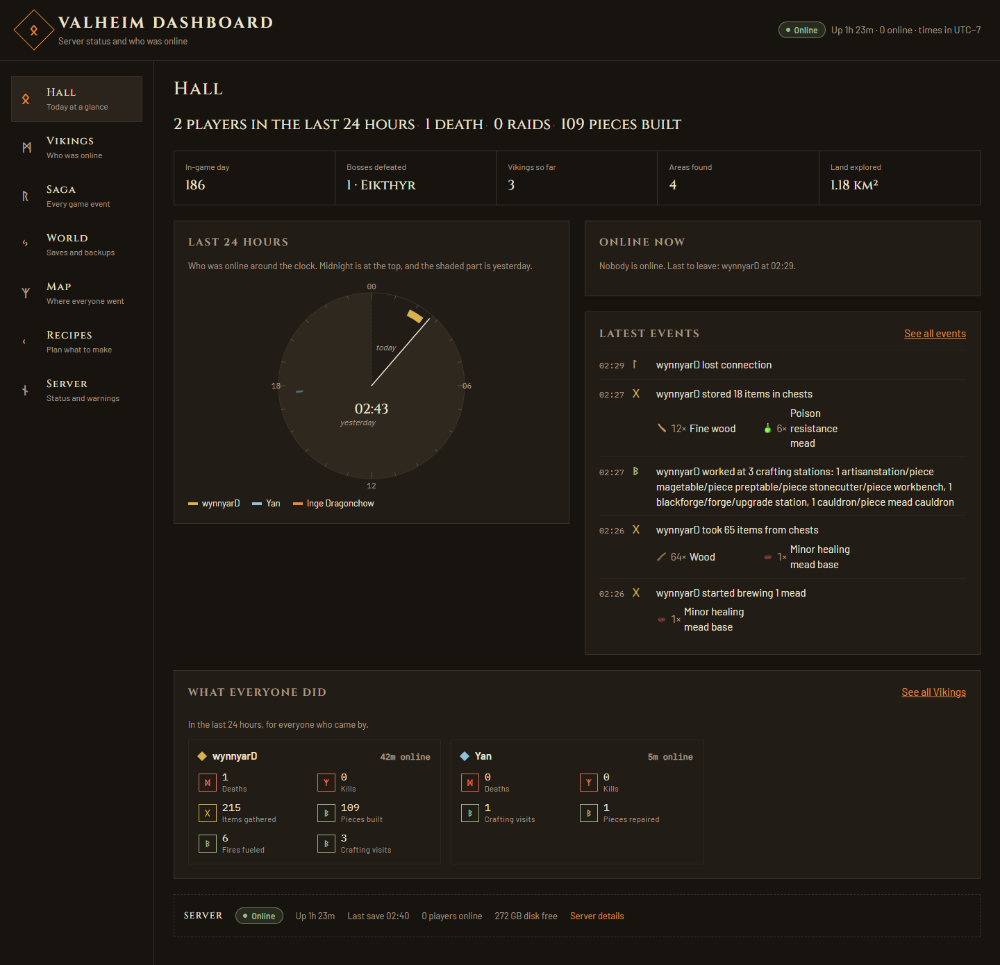

# Valheim dashboard

[](https://github.com/cristiadu/valheim-dashboard/actions/workflows/ci.yml)

A little web page for our Valheim server. It runs on the PC that hosts the game, reads the server's log as
it's written, and shows friends who's online, who played when, who died, what got built, and when the
world last saved. It also has a recipe planner for working out what you still need to gather.



## Run it

You need [Node.js](https://nodejs.org) 26 or newer on the server PC.

**Double-click `scripts\start-valheim.cmd`.** It starts the dashboard and the friends' link when they are
not already running, then checks `main` every 5 minutes. A commit that changes the dashboard or its packages
rebuilds and restarts the dashboard.
When the event log plugin changed and nobody is online, it builds the plugin, asks the game server to save
and exit, copies the DLL in, and starts the server again. It only takes a commit once CI passed on it. The
first check builds the dashboard once and records the plugin already installed. Logs go next to
`C:\Valheim Server\logs.txt`.

## Share it with friends

Friends open one link and type a password. They install nothing. The first time, make a free account at
[myzrok.io](https://myzrok.io), copy your account token, and run in PowerShell:

```powershell
.\scripts\start-valheim.ps1 -ZrokToken "<your token>"
```

Friends open `https://cotil-longhouse.shares.zrok.io`, click past zrok's notice the first time, and type the
Valheim server's password on the dashboard's password page. The dashboard reads it from
`start_headless_server.bat`, so change it there and restart the dashboard. The page remembers them for 30
days. Pass `-LinkName` for another name in the link. Other settings are in
[apps/dashboard/README.md](apps/dashboard/README.md).

## Work on it

```powershell
pnpm install
$env:LOG_FILE = "C:\Valheim Server\logs.txt"
pnpm --filter dashboard dev   # live reload at http://localhost:5173
pnpm check                    # types
pnpm test                     # tests
pnpm coverage                 # tests, with unit and integration coverage
pnpm build                    # what CI runs last
```

## Learn more

- [How it works](docs/architecture.md)
- [Log lines it reads](docs/log-events.md), including the optional event log plugin
