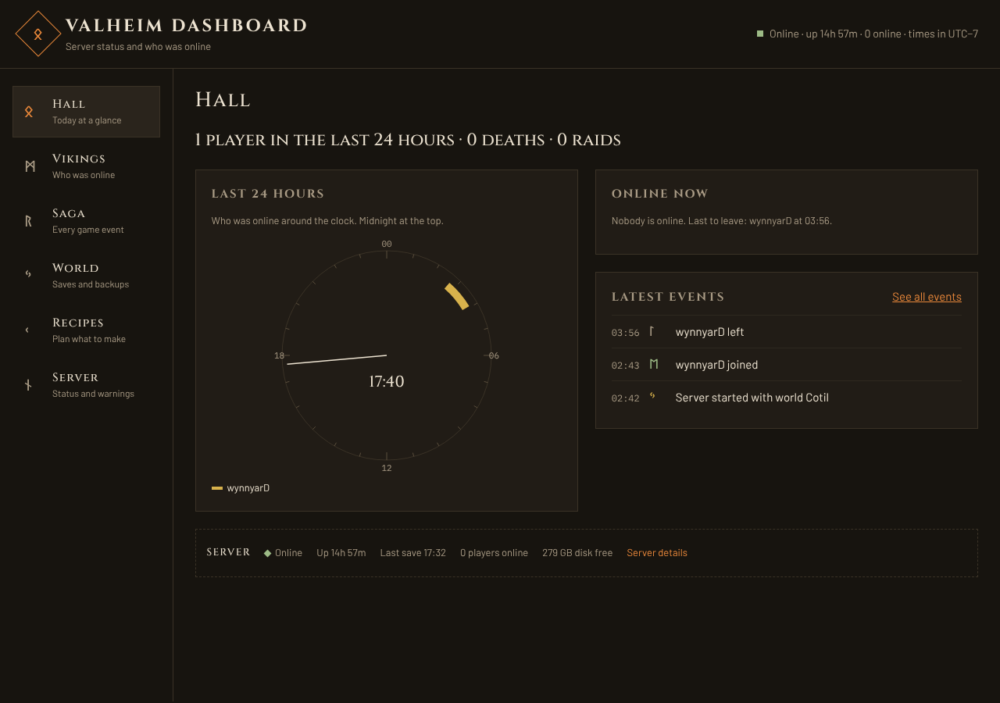

# Valheim dashboard

[](https://github.com/cristiadu/valheim-dashboard/actions/workflows/ci.yml)

A little web page for our Valheim server. It runs on the PC that hosts the game, reads the server's log as
it's written, and shows friends who's online, who played when, who died, what got built, and when the
world last saved. It also has a recipe planner for working out what you still need to gather.



## Run it

You need [Node.js](https://nodejs.org) 26 or newer on the server PC.

1. Double-click `scripts\start-dashboard.cmd`. The first time, it installs and builds everything.
2. Open http://localhost:3000. Only this PC can open that address. Friends use the shared link below.

It reads `C:\Valheim Server\logs.txt` and writes its own output to `C:\Valheim Server\dashboard.log`. If it
stops, it starts again after 5 seconds.

To start it every time you log on to Windows, double-click `scripts\install-startup.cmd` once. It runs
hidden, with no window. It also checks `main` every 5 minutes: it pulls, rebuilds and restarts the
dashboard, and installs a changed event log plugin when nobody is online. It writes what it did to
`C:\Valheim Server\updater.log`.

## Share it with friends

Friends open one link and type a password. They install nothing.

1. Make a free account at [ngrok.com](https://dashboard.ngrok.com/signup). Copy your auth token, and the free
   domain under Domains.
2. In PowerShell, run once:

   ```powershell
   .\scripts\share-dashboard.ps1 -Domain "longhouse.ngrok-free.app" -AuthToken "<your token>"
   ```

Friends open `https://longhouse.ngrok-free.app`, click past ngrok's notice the first time, and type the
Valheim server's password on the dashboard's password page. The dashboard reads it from
`start_headless_server.bat`, so change it there and restart the dashboard. The page remembers them for 30
days. The link starts hidden each time you log on. `share-dashboard.ps1 -Remove` stops sharing.

After a manual `git pull`, start it with `scripts\start-dashboard.cmd -Rebuild`. Other settings are in
[apps/dashboard/README.md](apps/dashboard/README.md).

## Work on it

```powershell
pnpm install
$env:LOG_FILE = "C:\Valheim Server\logs.txt"
pnpm --filter dashboard dev   # live reload at http://localhost:5173
pnpm check                    # types
pnpm test                     # tests
pnpm build                    # what CI runs last
```

## Learn more

- [How it works](docs/architecture.md)
- [Log lines it reads](docs/log-events.md), including the optional event log plugin
