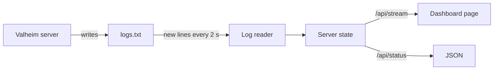
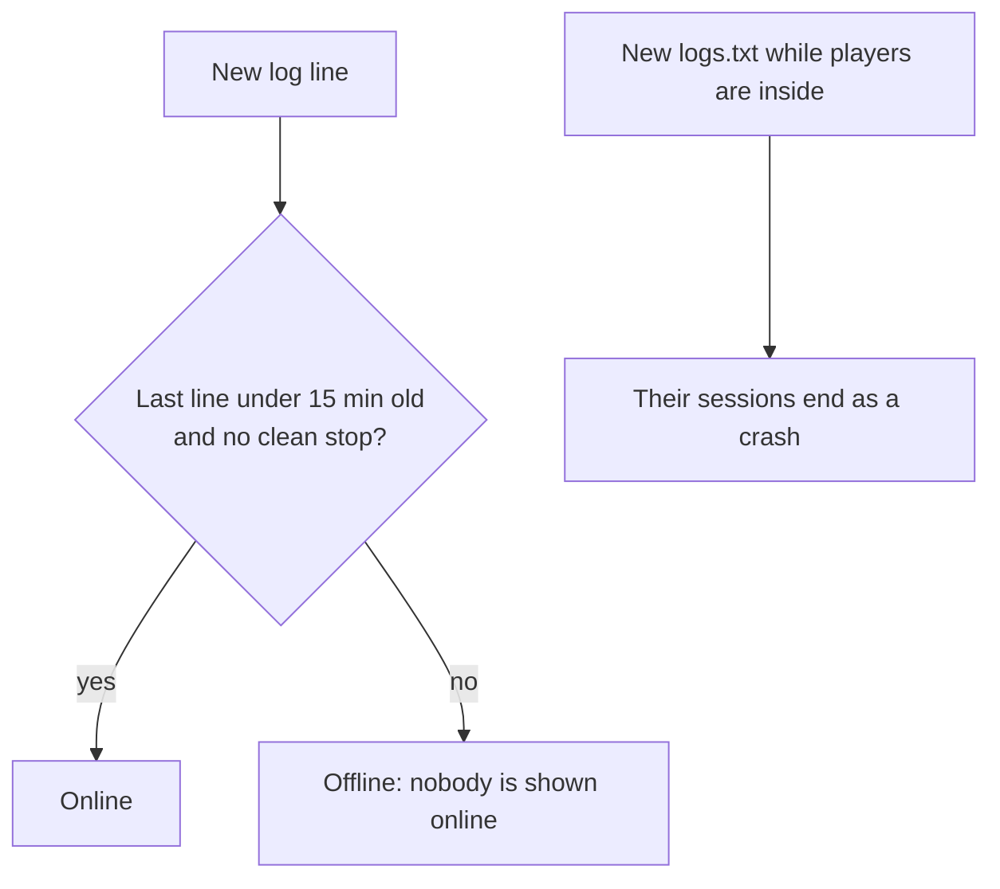
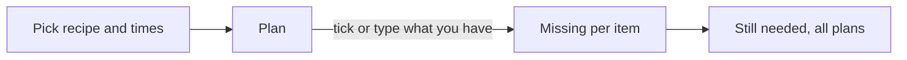

# Valheim dashboard

A small web server that runs on the Valheim server PC. It reads `logs.txt` as the game writes it and shows friends who is online, what happened and how the server is doing.



## Run it

In PowerShell, from the repo folder:

```powershell
pnpm install
pnpm --filter dashboard build
$env:LOG_FILE = "C:\Valheim Server\logs.txt"
node apps/dashboard/build
```

Then open `http://localhost:3000`. Set `PORT` to use another port.

### Keep it running

`scripts/start-dashboard.ps1` builds the dashboard if there is no build yet, starts it, and starts it again 5 seconds after it stops. Its output goes to `apps/dashboard/dashboard.log`.

```powershell
.\scripts\start-dashboard.ps1
.\scripts\start-dashboard.ps1 -Rebuild   # after a git pull
```

To start it each time you log on to Windows, run this once:

```powershell
.\scripts\install-startup.ps1
.\scripts\install-startup.ps1 -Remove   # to stop that
```

Both scripts take `-LogFile` and `-Port`. If Windows blocks scripts, run `Set-ExecutionPolicy -Scope CurrentUser RemoteSigned` once.

| Setting | Default | What it is |
| --- | --- | --- |
| `LOG_FILE` | `C:\Valheim Server\logs.txt` | The server's log file |
| `SERVER_UTC_OFFSET_MINUTES` | This PC's offset | The server clock's offset from UTC, for example `-420` for UTC−7 |

## How it decides what is true



- Log times are the server PC's clock. They are stored in UTC and shown in each viewer's time zone.
- History stays in memory while the dashboard runs. It survives server restarts, not dashboard restarts.

## Recipes tab

Each viewer plans what they want to craft. A plan is a recipe and how many times to make it. For each item you tick it off or type how many you have. "Still needed" adds up what every plan is missing.



- Plans are saved in the viewer's browser, so each friend has their own and the server stores nothing.
- Item icons load from the Valheim wiki in the viewer's browser. If one fails, the name shows alone.
- Recipes are a fixed list of common Valheim recipes at quality level 1, in `src/lib/recipes.ts`.
