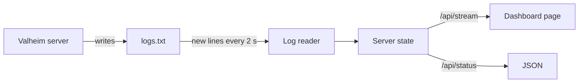
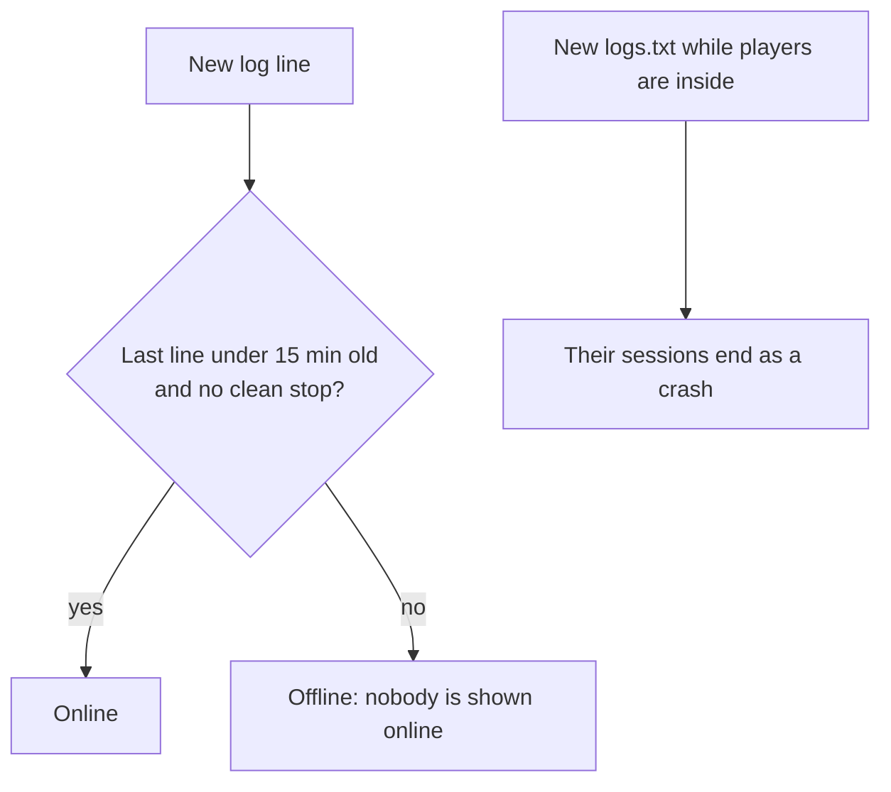

# Valheim dashboard

A small web server that runs on the Valheim server PC. It reads `logs.txt` as the game writes it and shows friends who is online, what happened and how the server is doing.



## Run it

In PowerShell, from the repo folder:

```powershell
pnpm install
pnpm --filter dashboard build
$env:LOG_FILE = "C:\Valheim Server\logs.txt"
node apps/dashboard/build
```

Then open `http://localhost:3000`. Set `PORT` to use another port.

| Setting | Default | What it is |
| --- | --- | --- |
| `LOG_FILE` | `C:\Valheim Server\logs.txt` | The server's log file |
| `SERVER_UTC_OFFSET_MINUTES` | This PC's offset | The server clock's offset from UTC, for example `-420` for UTC−7 |

## How it decides what is true



- Log times are the server PC's clock. They are stored in UTC and shown in each viewer's time zone.
- History stays in memory while the dashboard runs. It survives server restarts, not dashboard restarts.
