# How the dashboard works

The dashboard runs on the Valheim server PC. It reads the server's `logs.txt` and shows friends what
happens in the game, live, in their browser.

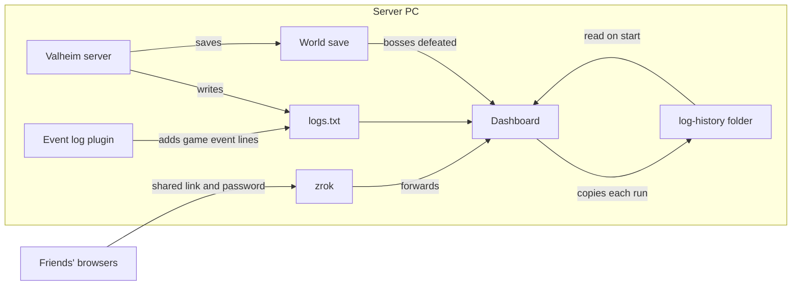

## Parts

| Folder | What it is |
| --- | --- |
| `packages/valheim-log` | Turns log lines into game events and player sessions. No files, no network. |
| `apps/dashboard` | SvelteKit app on Node. Follows `logs.txt` and serves the page. |
| `plugins/event-log` | BepInEx plugin on the server only. Logs what the game does not. Friends install nothing. |
| `scripts` | Start the dashboard, keep it running and update it from `main` on Windows, and share it through zrok. |
| `docs/log-events.md` | Every log line the dashboard reads, with its regex. |

## Reading a log line

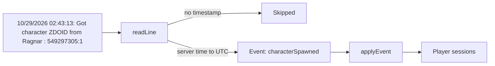

Server times are local (UTC−7 on this PC) and are stored as UTC. One Steam ID is one player.

## Showing times

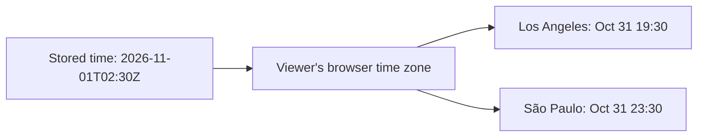

Every time on the dashboard is shown in the time zone of the browser looking at it. Each time uses the offset its zone had on that day, so times stay right after daylight saving changes.

## Following logs.txt

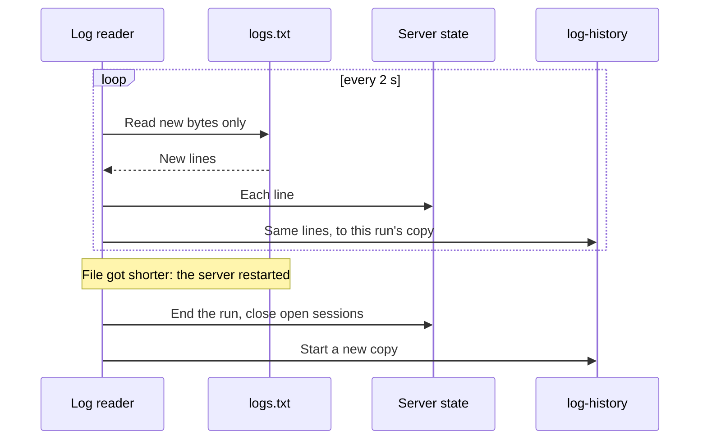

| A run ends as | When |
| --- | --- |
| `stopped` | The log has a clean stop line. |
| `crashed` | A new `logs.txt` started without a clean stop. |

## Starting the dashboard

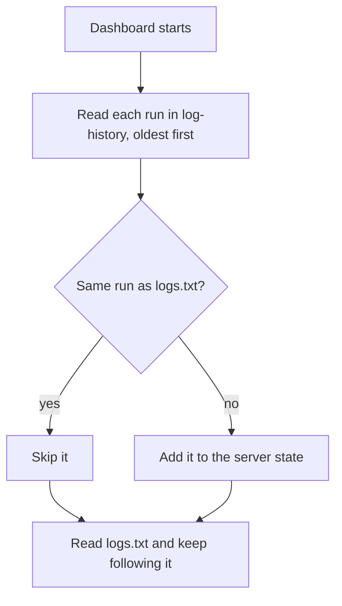

The server overwrites `logs.txt` on each start, so `log-history` keeps every run. Copies are named by the
run's first line, for example `20261030-154346.txt`.

## Live updates to the page

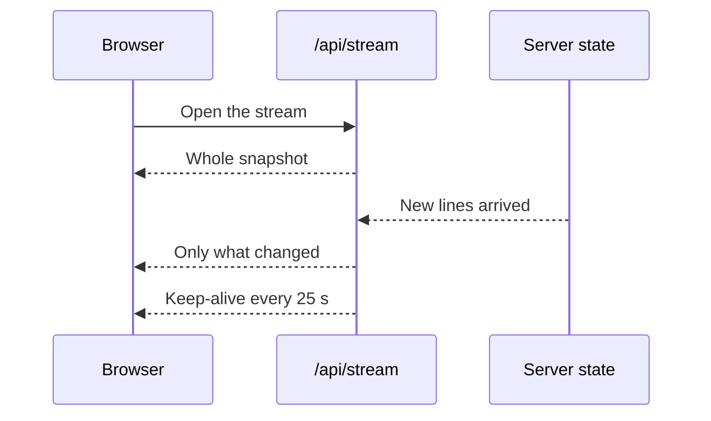

A snapshot is everything the page shows, as JSON. `/api/status` returns the same snapshot once.

The browser applies each change to its last snapshot. The stream and the pages are sent gzip-compressed,
and a tab change reuses the snapshot the page already has.

| A change says | Example |
| --- | --- |
| A new value | `day` went from 11 to 12 |
| A list lost items at the front and got new ones at the end | the oldest event dropped, one new death added |
| An object's keys changed, are new, or are gone | Ragnar moved on the map |

## Sharing with friends

The dashboard listens only on the server PC (`127.0.0.1`). zrok connects out from the PC and passes the
shared link's requests in, so no router port is open.
The link keeps its name, such as `https://cotil-longhouse.shares.zrok.io`. The first time, zrok shows the friend a
notice page with a button to go on.

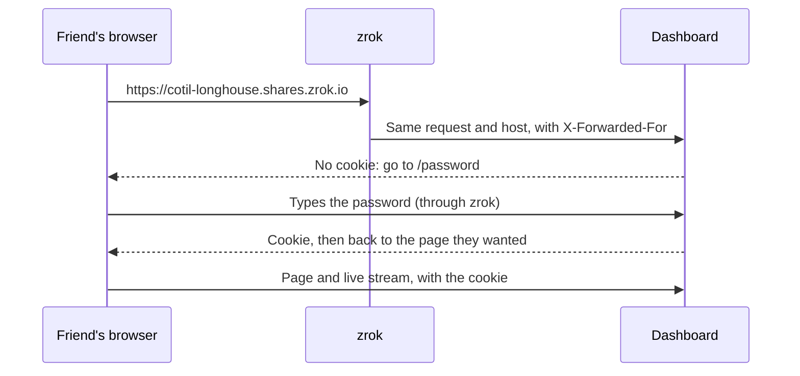

| A request | Gets |
| --- | --- |
| Made on the PC (host `localhost` or `127.0.0.1`, no `X-Forwarded-For`), such as `/api/status` for the updater | Served, no password |
| Through zrok with the cookie | Served |
| Through zrok without it | Sent to `/password`; `/api/*` answers `401` |
| Through zrok when no password is set | Turned away (`403`) |

The password is the Valheim server's own, which the start script reads from `-password` in
`start_headless_server.bat`. The cookie (`dashboard_pass`) lasts 30 days. It holds a hash made from the password, so changing the
password sends everyone back to the password page. A wrong password waits 1 second before the answer, so
guessing is slow.

## Bosses defeated

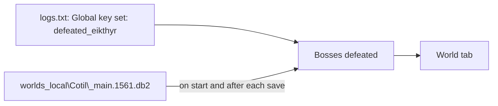

A boss defeat sets a global key, such as `defeated_eikthyr`, which the world save keeps. The log only has
defeats since the plugin was installed, so the dashboard also reads the keys from the newest save. A defeat
from the save shows on the World tab, but has no Saga line, since its time is not known.

The World tab lists only bosses someone has defeated or summoned. A boss nobody has met stays hidden, so
the page gives nothing away.

## Tabs

| Tab | Shows | Data from |
| --- | --- | --- |
| Hall | Who is online and where, the last 24 hours on a day wheel, the latest events | Snapshot |
| Vikings | Each player now: when they were online, health and stamina, their numbers, areas visited, gear laid out like a character sheet, and what is probably in their bag | Snapshot |
| Saga | Every game event and chat, with filters | Snapshot |
| World | The in-game day, bosses defeated, saves, backups, disk space | Snapshot |
| Map | Land each player walked, chests with what they hold, who is where, last deaths | Snapshot |
| Recipes | Crafting plans and what is still missing, and what the chests can make. Only recipes whose ingredients someone has found | The viewer's browser, and chests and found items from the snapshot |
| Server | Up or down, uptime in the last 24 hours, warnings | Snapshot |

Recipe plans are saved in each viewer's browser (`localStorage`). The server stores nothing for them. Chest items are matched to recipe items through `itemName`, so `RoundLog` counts as `Core wood`. Only chests someone has found count.

Recipes can also count one character's bag, and Vikings shows it. The server never gets a player's inventory, so the bag is a guess
kept in the snapshot:

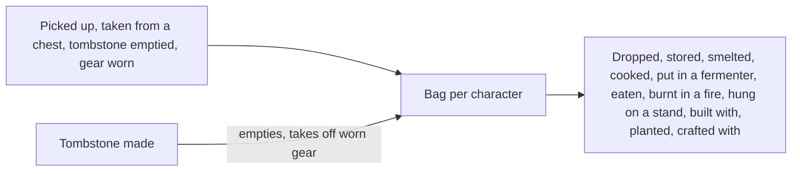

Building and planting take out what the piece costs, from `piece-costs.txt` (`wood_floor Wood x2`). Crafting takes
out what the recipe costs, from `craft-costs.txt` (`ArrowWood 1 20 Wood x8`). The plugin writes both next to
`logs.txt` on each start. A craft is only seen once the made item reaches a chest or the ground, so the guess can
be off. Gear worn now always stays in the bag.

A meal takes one food out. When the log only says `Ate something`, it is the food the player carries most of,
skipping foods eaten in the last 20 minutes, since a food still in effect can't be eaten again. Each `Fueled`
line takes out one of what that fire burns. Both lists come from the plugin: `foods.txt` and `fire-fuels.txt`
(`piece_groundtorch_wood Resin`).

Items on the ground have an ID, the game's object ID. The same ID is on the drop and the pickup, so an item
counts once however often it is seen:

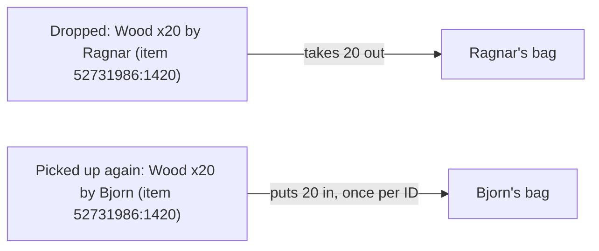

Stacked items such as wood have no ID of their own in the game, only a kind and a count, so the bag counts them
that way. IDs are never shown.

Every player's bag has the game's 8 by 4 grid, 32 slots, and worn gear takes a slot there too, as in the game.
Megingjord adds carry weight, not slots. Items fill slots in stacks of the size the game gives each one:

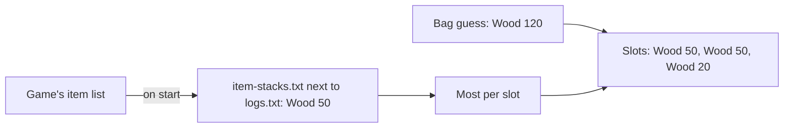

The guess never needs more than 32 slots. When it would, the stackable material touched longest ago is taken out,
as it most likely went into crafting. Gear and tools go only when no material is left, and what a player wears
now never does.

The plugin logs everything a player wears, holds or carries on the back whenever it changes (`Wearing:`). The
Vikings character sheet puts each of those pieces in its slot, at the newest level seen in the gear lines, and
marks them in the bag. Pieces with no slot of their own, such as a torch or the hammer, show under "Also in
hand". Until a character's first `Wearing:` line, the newest piece seen of each slot stands in.

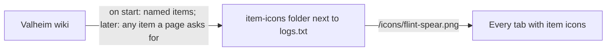

Each Vikings card also shows health, max health, stamina and eitr. The game keeps these on the player's world
object, so the plugin's world scan sees them. It rewrites a small file whenever a number changes:

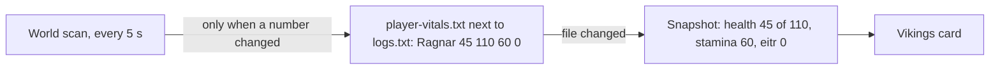

| Number | Meaning |
| --- | --- |
| Health | Health now, and the most it can be with the food eaten, shown as a bar |
| Stamina | Stamina now. The server never gets the max, so it shows as a number |
| Eitr | Eitr now, shown only once it is above 0 |

The file only lists players online. Players who left keep the numbers from when they were last seen, until the
dashboard restarts. Skill levels never reach the server, so Vikings cannot show them.

Icons for every recipe item and named piece of gear download on start. Any other item, such as one only
`item-stacks.txt` lists, downloads the first time a page shows it. The wiki is asked once per item per run.

## Where a number comes from

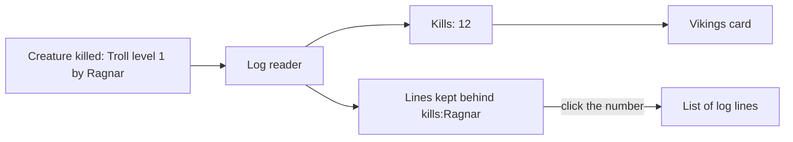

Each line that changes a number or an item on Vikings is kept with it, so a click shows the lines behind it,
newest first. Only the latest 50 lines per number are kept, but all of them are counted.

| Kept for | Lines |
| --- | --- |
| Time played, visits | Joins and leaves |
| Deaths | The game's death line and the plugin's death details |
| Kills, most killed | Creature killed |
| An area | Area entered |
| A piece of gear | Gear first seen, at each level, and each change to what is worn |
| Pieces built, items gathered and the other activity numbers | Each plugin line of that activity |

Each Saga and Hall event keeps its lines too: a game event, chat message or ping has its own line, a death
has the game's line and the plugin's details, a join or leave has its line from the table above, and a
stretch of building, kills or items keeps its latest 50 lines. Every line in the list shows the rune, color
and label of its Saga kind.

The server numbers on World, Server and the Hall keep their lines the same way:

| Number | Lines |
| --- | --- |
| World, up for, status | World loaded and clean stops |
| In-game day | New day and night skipped |
| Saves seen, average save time, each save | Save finished |
| Backups seen, each backup | Backup created |
| Disk free, low disk warning | Free disk space |
| Steam, lost Steam warning | Steam connected or lost |
| A boss defeated | The defeat's global key. A boss read only from the world save has none. |
| Last log line | The newest line |
| Crash warning | The last line before the crash |
| Hall summary | Joins and leaves, deaths, raids and pieces built in the last 24 hours |

## Event log plugin

The game logs joins, deaths and saves, but not building, chat or boss progress. The plugin watches what
already passes through the server and writes a line for each event.

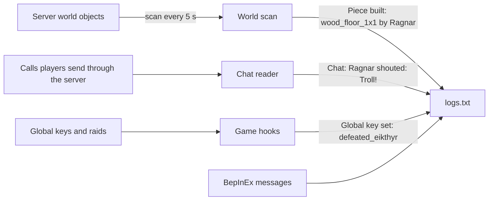

| Source | What it finds |
| --- | --- |
| World scan | New objects (pieces, plants, summoned bosses), items put into smelters, food put on cooking stations, mead bases put into fermenters, who takes the helm of each ship, who rides each tame, saddles, who each tame follows, who pulls each cart, fuel put on fires, pieces repaired, maps shared on map tables, items put on armor stands, beds claimed, portal names, wards turned on or off, who has access to each ward, the in-game day, each player's position, area, portal trips, death, PvP, bed, gear, health, stamina and eitr, what each chest, cart, ship and new tombstone holds, items players made or upgraded (each crafted item keeps its maker's name and level), tames, signs, item stands, chests and harvested plants, and objects destroyed, such as creatures with every player who hit them, trees cut down, rocks mined out, items picked up and emptied tombstones |
| Calls through the server | Chat and map pings, which the server passes from one player to the others, creature attack moves, to say what a player was fighting when they died, each player starting to eat or using a forsaken power, each vegvisir or rune stone read, and who asked to harvest a plant, hit a tree or rock, fill a smelter or fermenter, name a portal, saddle a tame, fuel a fire, repair a piece, share a map or pull an obliterator's lever, and each lever pull |
| Every frame | For each online player: food shown in their hand, which only happens while they eat or drink and lasts about a second, the crafting station kind they opened, and each emote |
| Game hooks | Global keys, such as a boss defeat, and the end of a raid |

Each line names a player only when the game data says who did it.

The server sends its own log only to `logs.txt`, so the plugin also shows each event line in the server's
console window, for example `[Info   :Game event] Chat: Ragnar shouted: Troll!`. Only `logs.txt` feeds the
dashboard. The plugin turns off click-to-select in that window: a selection pauses writes to the window, which
would freeze the server.

On the dashboard, plugin lines become:

| Kept as | Lines | Shown as |
| --- | --- | --- |
| Activities | Pieces built or destroyed, kills, items gathered, chests, planting, eating, smelting, cooking, brewing, steering ships, crafting station visits, emotes, items made or upgraded, rides, forsaken powers, carts pulled, fires fueled, repairs, items obliterated, trees and rocks | One Saga line per player and kind, until a 10 minute pause, naming every thing, and a running total per player and kind for the Vikings numbers |
| Story events | Deaths, bosses, raids, portals, tames, signs, item stands, tombstones, beds claimed, portals named, wards turned on or off, stones read, saddles, tames following, ward access, maps shared | One Saga line each |
| News only | Areas, gear, global keys | A Saga line for a first visit or a dungeon trip, new gear, or a boss defeat |
| Stats | Areas, kills, the day, boss keys | Where each player is now and their kills, areas and gear on Vikings, the day and bosses on World |
| Chat | Chat and pings | The Saga's "Chat and signs" filter, kept apart so it never pushes out events |
| Map | Positions, chests, tombstones | Explored squares, chests and last deaths on Map, and the land each player explored on Vikings |

### Gathering

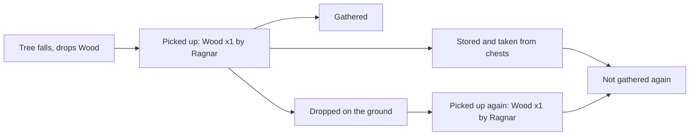

An item counts as gathered only the first time anyone picks it up. Harvest lines are not counted, since the
player then picks up what the plant drops, which is already counted.

### Map

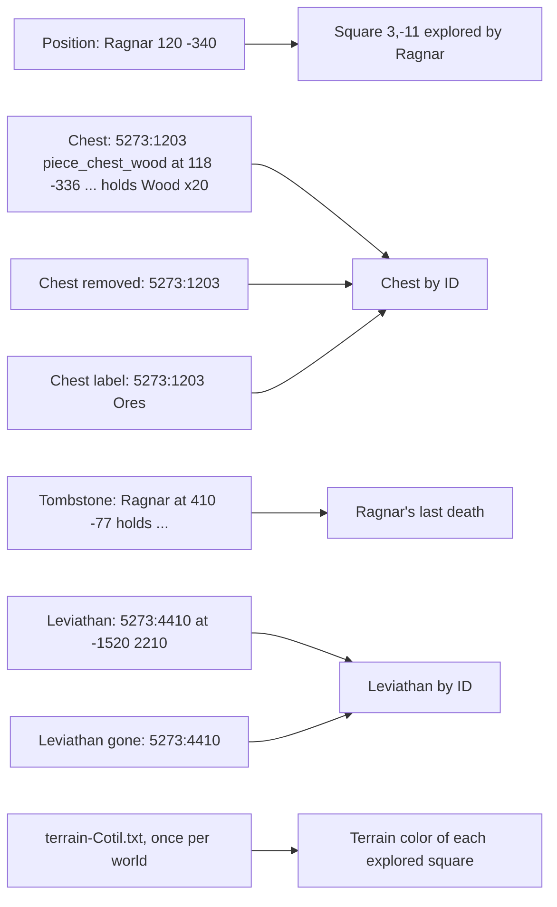

A position marks its whole 32 m square as explored. Chest IDs last until the server stops, and every run lists
all chests again, so a new run starts the chest list over. The plugin writes the terrain file once per world
from the game's own world generator, and the map colors only squares someone walked.
Nothing nobody has seen shows: a chest or Leviathan appears only on a square someone walked.
The map uses the game's own coordinates: `x` east and `z` north of the world's center, the same numbers the
game's `pos` command prints. The world is a circle 10,500 m from the center to its edge, which the terrain file
covers in full. The map opens on the explored land, drawn to the world's true scale, and zooming out goes as far as
the whole world, so you can see where the explored land sits in it.

| Map part | What it shows |
| --- | --- |
| Dashed ring | Edge of the world, 10,500 m from the center |
| Scale bar | A plain distance, such as 500 m, at the current zoom |
| Spot under the pointer | Game `x` and `z`, and how far it is from the center |
| Chest, world chest, cart, ship | Each with its own drawing |
| Line and dot from a chest | The chest was set beside its neighbors, and the dot is where it really stands |

A sign put right against a chest names it, for example `Ores`: the plugin finds signs within 1.25 m of a chest,
and each sign names only its closest chest. The map then calls the chest by that name everywhere, with the chest's
kind beside it.

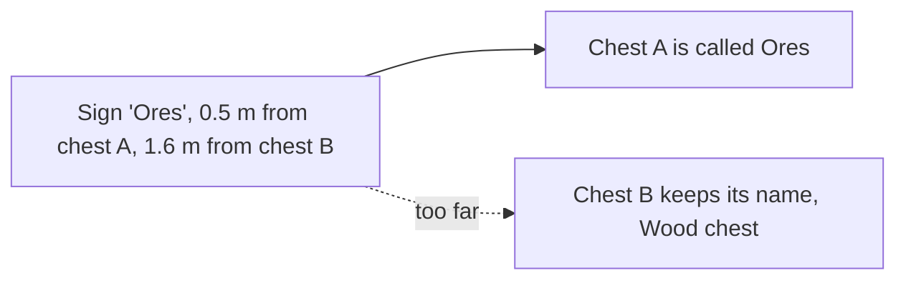

Every chest has its own mark. Marks are small zoomed out and grow as the map zooms in. Once the view
is no wider than the explored land, chests that would cover each other sit side by side. Pointing at a chest shows a box with its name or sign, who built it and how many slots are full. Tapping one opens it as the
game's slot grid, and pointing at a slot shows the item's name and count. Item names and icons come from the item's prefab, through
`GEAR_NAMES` and `ITEM_NAMES`, or the prefab split into words. An item the wiki has no icon
for shows a plain sack.

BepInEx's own log file is turned off, so its messages land in
`logs.txt` too. Every line is listed in [log-events.md](log-events.md).

## Start script

`start-valheim.ps1` is the one script that starts everything, by hand (`start-valheim.cmd`) or from the
`Valheim` logon task it adds. Each part gets its own window, and a part that already runs is left alone.

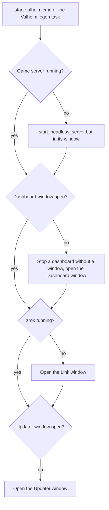

| Window | Loop |
| --- | --- |
| Dashboard | Build if there is none, run node, wait 5 s after it stops, run it again |
| Link | Delete a leftover share on the link's name, run zrok, wait 30 s after it stops, run it again |
| Updater | Run one update as its own PowerShell, wait 5 minutes, again |

Run by hand, it installs pnpm and zrok when they are missing, adds the logon task, and then starts that task
instead of the windows. The windows then belong to Task Scheduler, not to whatever ran the script: windows
started from an app's shell close when that app quits or updates. From the task it installs nothing.

A share zrok had when the PC shut down keeps the link's name, and zrok refuses a new share on that name. With
no other zrok running, that share is stale, so the Link window deletes it first.

## Updates from main

The Updater window runs one update every 5 minutes. Each is its own PowerShell, so a failed update never
stops the loop, and each reads the script as `main` has it now.

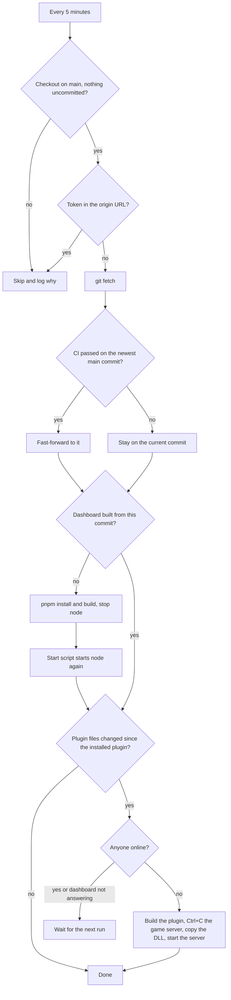

| Step | How |
| --- | --- |
| Who is online | Sessions without an end in `/api/status`. |
| Stopping the game server | Ctrl+C sent to its console, as in its window. The game saves the world and exits. |
| Starting the game server | `start_headless_server.bat` in its own console window, in the foreground. A server that was already stopped stays stopped. |
| Remembering what is installed | `updater-state.json` keeps the commit of the running dashboard and of the installed plugin. A step that fails or waits runs again on the next pass. |

The first run takes the installed plugin as current and builds the dashboard once.

### What it trusts

Whatever reaches `main` runs on the server PC as its Windows user, with nobody watching: the build scripts,
the plugin build and the plugin inside the game server. These keep that to reviewed code.

| Guard | What it stops |
| --- | --- |
| CI check | A commit runs only after the `ci` job passed on GitHub, read from GitHub's public check-runs API. |
| Fast-forward only | A rewritten `main` stops updates instead of being followed. |
| Installed pnpm | Builds use the pnpm `start-valheim.cmd` installed, and stop if `package.json` asks for another version. Nothing downloads pnpm unattended. |
| `--frozen-lockfile` | Installs exactly the lockfile's packages, checked against their hashes. pnpm does not run packages' install scripts. |
| Dependabot cooldown | Upgrades are offered once a version has been out for 7 days. |
| Plain origin URL | A token in the URL could end up in `updater.log`, so the run skips. |
| Commit hashes only | Values from `updater-state.json` reach git only as full commit hashes. |

## Files on the server PC

Every log lives in `C:\Valheim Server`.

| File | Written by |
| --- | --- |
| `logs.txt` | The Valheim server, the event log plugin and BepInEx |
| `log-history\*.txt` | The dashboard, one file per server run |
| `dashboard.log` | The Dashboard window, with the dashboard's output |
| `updater.log` | The Updater window: what it updated, skipped or is waiting for |
| `updater-state.json` | The Updater window: commits of the running dashboard and the installed plugin |
| `zrok.log` | zrok's output while it shares the link |
| `terrain-<world>.txt` | The event log plugin, once per world: the land type of every 32 m square |
| `item-stacks.txt` | The event log plugin, once per start: the most of each item one slot holds |
| `piece-costs.txt` | The event log plugin, once per start: what building each piece takes |
| `craft-costs.txt` | The event log plugin, once per start: what crafting or upgrading each item takes |
| `foods.txt` | The event log plugin, once per start: every item that is food |
| `fire-fuels.txt` | The event log plugin, once per start: the item each fire burns |
| `game-names.txt` | The event log plugin, once per start: the English name the game shows for each item, piece, creature and raid. Every name on the page uses it first, so `AtgeirIron` reads `Iron atgeir` and `army_theelder` reads `The ground is shaking` |
| `player-vitals.txt` | The event log plugin, when a number changes: health, max health, stamina and eitr of each player online |

The dashboard also reads the world save, `worlds_local\Cotil\_main.<save number>.db2`, and never writes to it.

## CI

```mermaid
flowchart LR
  pr[Pull request or push to main] --> install[pnpm install] --> check[pnpm check] --> lint[pnpm lint] --> coverage[pnpm coverage] --> build[pnpm build] --> scripts[Measure-Coverage.ps1]
  scripts --> summary[Run summary]
  scripts --> comment[Comment on the pull request]
```

`pnpm coverage` runs each project's tests twice, once per kind, and writes what they ran to
`coverage/<kind>/cobertura-coverage.xml` in that project. `scripts\Measure-Coverage.ps1` does the same for the
PowerShell scripts with Pester 6.2.0, then turns all those files into one table.

| Test kind | What it checks | Files |
| --- | --- | --- |
| Unit | One source file at a time | `*.test.ts`, `*.Tests.ps1` |
| Integration | Several parts together on real files, for example the dashboard following a log folder in a temp folder, or the updater on a throwaway git checkout | `*.integration.test.ts`, `*.Integration.Tests.ps1` |

The comment is updated on each push, so a pull request has one. Dependabot's pull requests get only the summary,
since their token cannot comment. The event log plugin is not measured: it builds only against the game's own files.

`pnpm lint` runs ESLint in each project. Besides the recommended TypeScript and Svelte rules, it rejects
relative imports (use `#/`), `function` declarations, `.then()`, `console` and `if` without braces.

On the PC, `Invoke-Pester scripts` runs both kinds of script tests.

Dependabot opens weekly upgrade PRs for npm packages and GitHub Actions, for versions out for 7 days. The plugin is built on the
server PC, not in CI.
