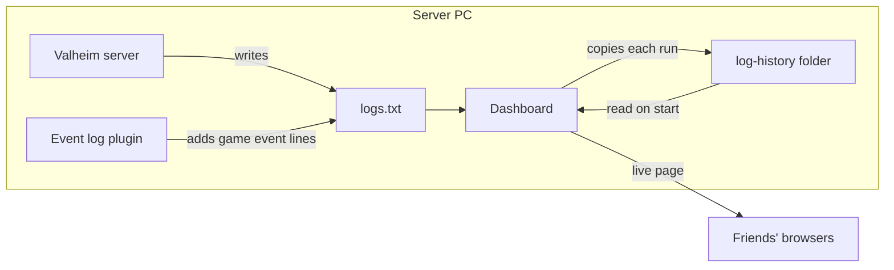
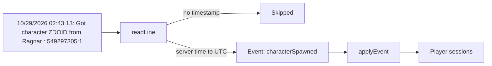
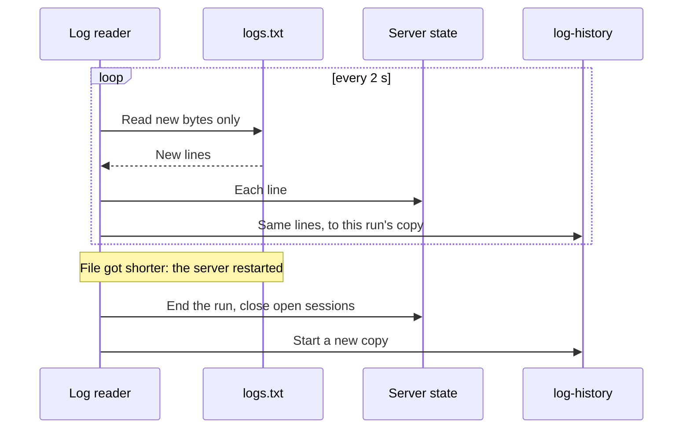
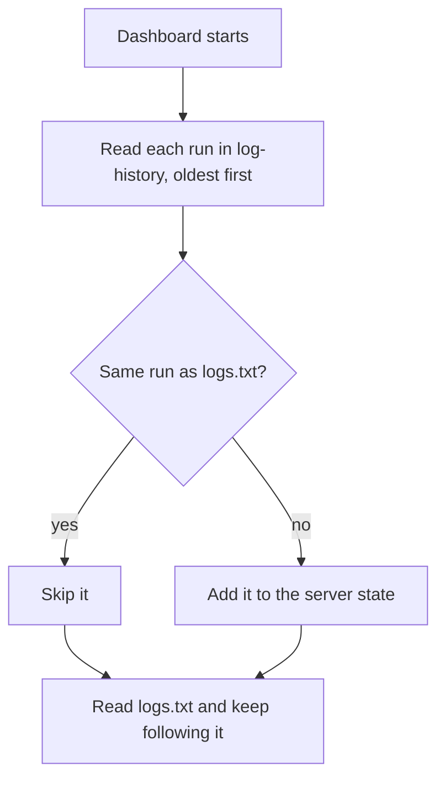
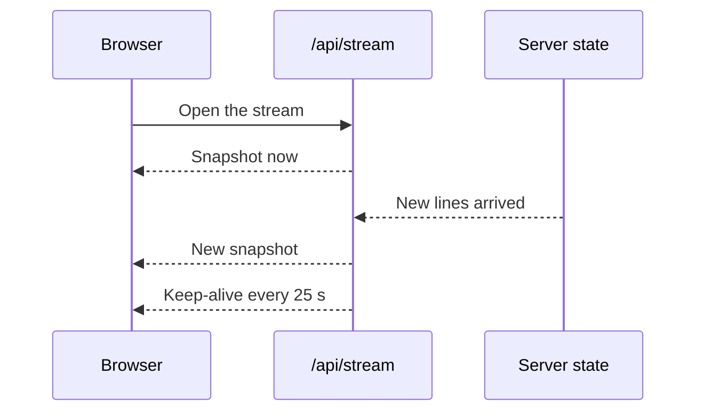
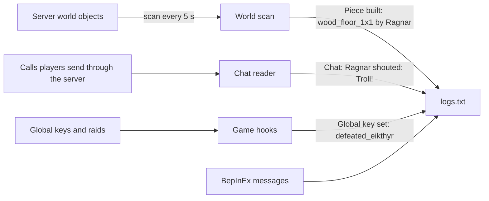
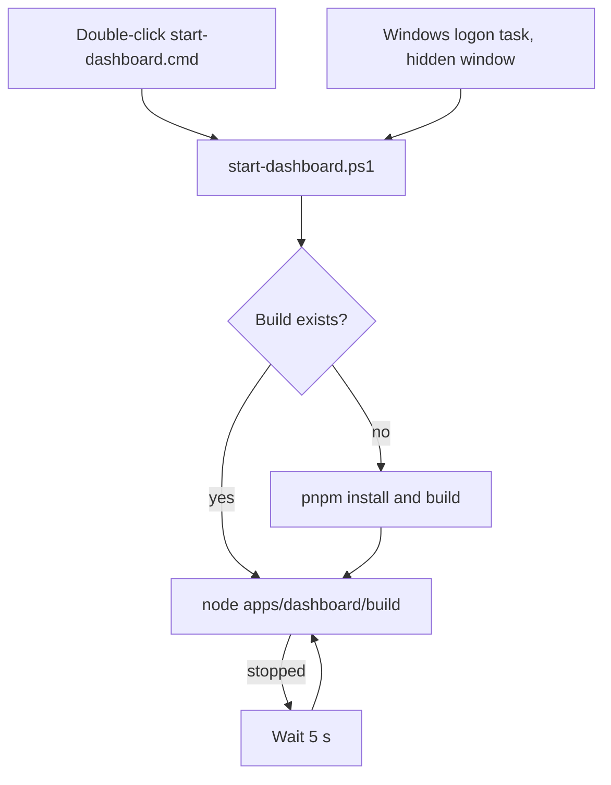
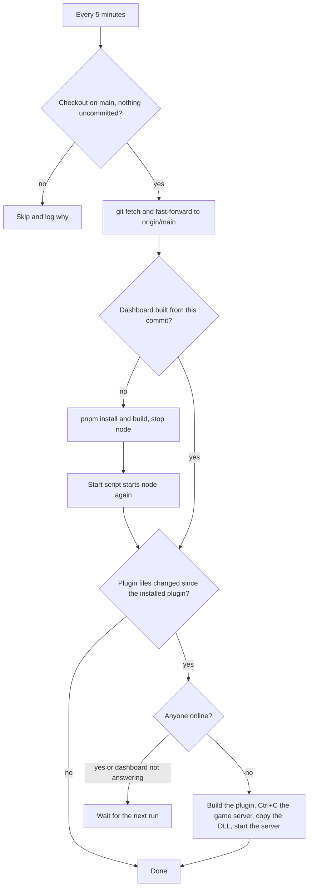
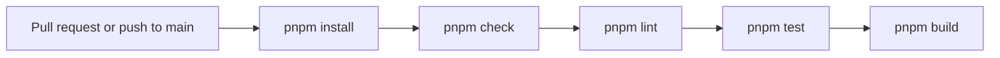

# How the dashboard works

The dashboard runs on the Valheim server PC. It reads the server's `logs.txt` and shows friends what
happens in the game, live, in their browser.

## Parts

| Folder | What it is |
| --- | --- |
| `packages/valheim-log` | Turns log lines into game events and player sessions. No files, no network. |
| `apps/dashboard` | SvelteKit app on Node. Follows `logs.txt` and serves the page. |
| `plugins/event-log` | BepInEx plugin on the server only. Logs what the game does not. Friends install nothing. |
| `scripts` | Start the dashboard, keep it running and update it from `main` on Windows. |
| `docs/log-events.md` | Every log line the dashboard reads, with its regex. |

## Reading a log line

Server times are local (UTC−7 on this PC) and are stored as UTC. One Steam ID is one player.

## Following logs.txt

| A run ends as | When |
| --- | --- |
| `stopped` | The log has a clean stop line. |
| `crashed` | A new `logs.txt` started without a clean stop. |

## Starting the dashboard

The server overwrites `logs.txt` on each start, so `log-history` keeps every run. Copies are named by the
run's first line, for example `20261030-154346.txt`.

## Live updates to the page

A snapshot is everything the page shows, as JSON. `/api/status` returns the same snapshot once.

## Tabs

| Tab | Shows | Data from |
| --- | --- | --- |
| Hall | Who is online and where, the last 24 hours on a day wheel, the latest events | Snapshot |
| Vikings | Each player, when they were online, kills, areas visited and gear | Snapshot |
| Saga | Every game event and chat, with filters | Snapshot |
| World | The in-game day, bosses defeated, saves, backups, disk space | Snapshot |
| Recipes | Crafting plans and what is still missing | The viewer's browser |
| Server | Up or down, uptime in the last 24 hours, warnings | Snapshot |

Recipe plans are saved in each viewer's browser (`localStorage`). The server stores nothing for them.

## Event log plugin

The game logs joins, deaths and saves, but not building, chat or boss progress. The plugin watches what
already passes through the server and writes a line for each event.

| Source | What it finds |
| --- | --- |
| World scan | New objects (pieces, summoned bosses), the in-game day, each player's area, portal trips, death, PvP, bed and gear, tames, signs, item stands, chests and harvested plants, and objects destroyed, such as creatures with every player who hit them, items picked up and emptied tombstones |
| Calls through the server | Chat and map pings, which the server passes from one player to the others, creature attack moves, to say what a player was fighting when they died, and who asked to harvest a plant |
| Game hooks | Global keys, such as a boss defeat, and the end of a raid |

Each line names a player only when the game data says who did it.

On the dashboard, plugin lines become:

| Kept as | Lines | Shown as |
| --- | --- | --- |
| Activities | Pieces built or destroyed, kills, pickups, harvests, chests | One Saga line per player and kind, until a 10 minute pause |
| Story events | Deaths, bosses, raids, portals, tames, signs, item stands, tombstones | One Saga line each |
| News only | Areas, gear, global keys | A Saga line for a first visit or a dungeon trip, new gear, or a boss defeat |
| Stats | Areas, kills, the day, boss keys | Where each player is now and their kills, areas and gear on Vikings, the day and bosses on World |
| Chat | Chat and pings | The Saga's "Chat and signs" filter, kept apart so it never pushes out events |

BepInEx's own log file is turned off, so its messages land in
`logs.txt` too. Every line is listed in [log-events.md](log-events.md).

## Start scripts

`install-startup.cmd` adds the logon task and the update task once. Every window stays hidden when it
starts at logon.

## Updates from main

The update task runs `update-from-main.ps1` every 5 minutes in a console with no window.

| Step | How |
| --- | --- |
| Who is online | Sessions without an end in `/api/status`. |
| Stopping the game server | Ctrl+C sent to its console, as in its window. The game saves the world and exits. |
| Starting the game server | `start_headless_server.bat` in a console with no window. A server that was already stopped stays stopped. |
| Remembering what is installed | `updater-state.json` keeps the commit of the running dashboard and of the installed plugin. A step that fails or waits runs again on the next pass. |

The first run takes the installed plugin as current and builds the dashboard once.

## Files on the server PC

Every log lives in `C:\Valheim Server`.

| File | Written by |
| --- | --- |
| `logs.txt` | The Valheim server, the event log plugin and BepInEx |
| `log-history\*.txt` | The dashboard, one file per server run |
| `dashboard.log` | The start script, with the dashboard's output |
| `updater.log` | The update script: what it updated, skipped or is waiting for |
| `updater-state.json` | The update script: commits of the running dashboard and the installed plugin |

## CI

`pnpm lint` runs ESLint in each project. Besides the recommended TypeScript and Svelte rules, it rejects
relative imports (use `#/`), `function` declarations, `.then()`, `console` and `if` without braces.

A second job runs the Pester tests of the PowerShell scripts.

Dependabot opens weekly upgrade PRs for npm packages and GitHub Actions. The plugin is built on the
server PC, not in CI.
