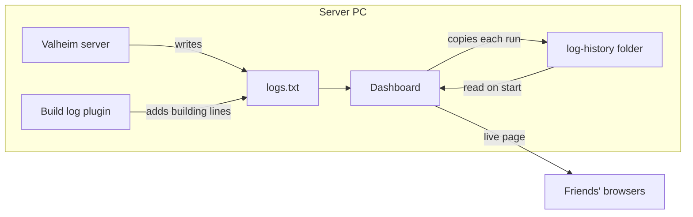
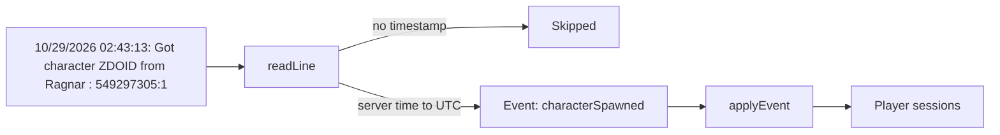
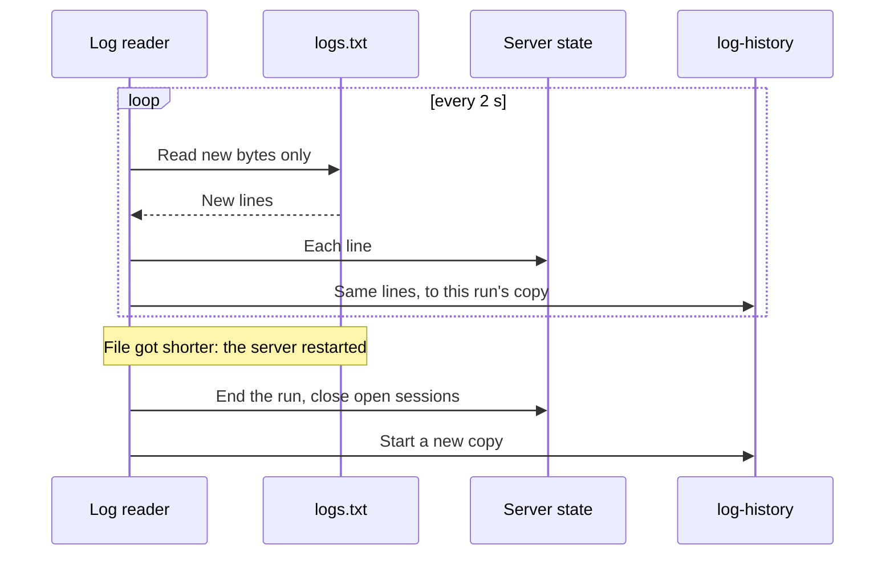
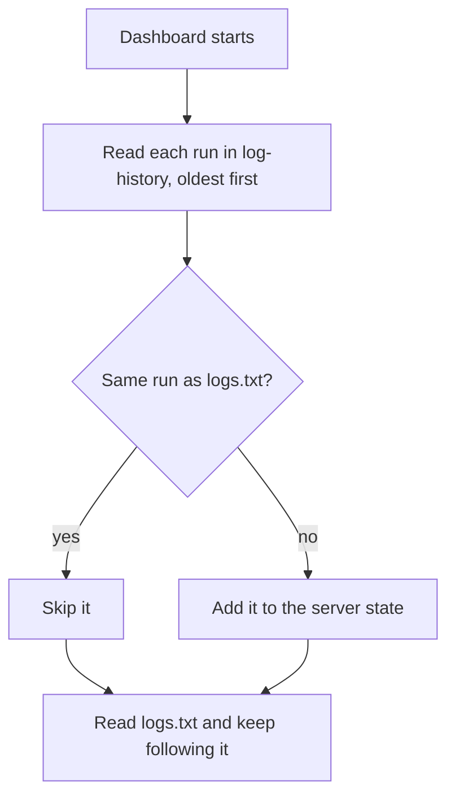
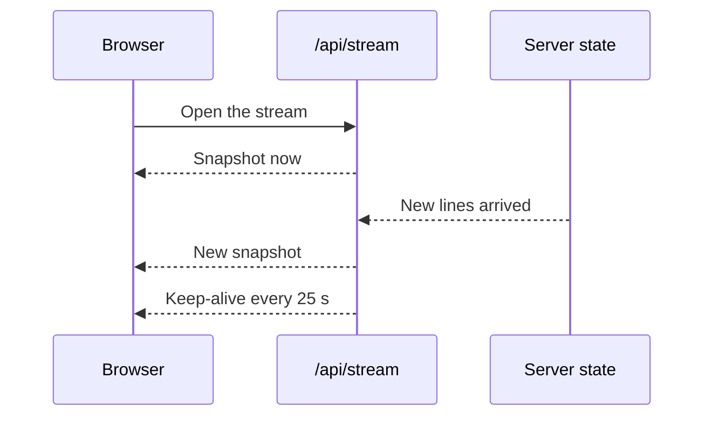
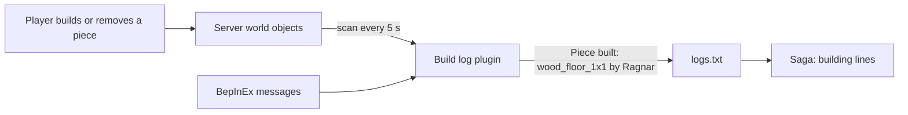
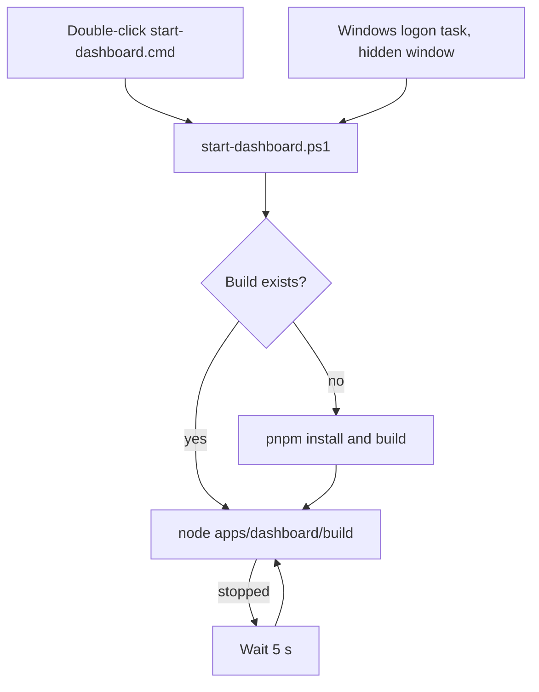
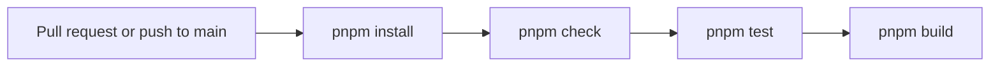

# How the dashboard works

The dashboard runs on the Valheim server PC. It reads the server's `logs.txt` and shows friends what
happens in the game, live, in their browser.

## Parts

| Folder | What it is |
| --- | --- |
| `packages/valheim-log` | Turns log lines into game events and player sessions. No files, no network. |
| `apps/dashboard` | SvelteKit app on Node. Follows `logs.txt` and serves the page. |
| `plugins/build-log` | BepInEx plugin on the server only. Friends install nothing. |
| `scripts` | Start the dashboard and keep it running on Windows. |
| `docs/log-events.md` | Every log line the dashboard reads, with its regex. |

## Reading a log line

Server times are local (UTC−7 on this PC) and are stored as UTC. One Steam ID is one player.

## Following logs.txt

| A run ends as | When |
| --- | --- |
| `stopped` | The log has a clean stop line. |
| `crashed` | A new `logs.txt` started without a clean stop. |

## Starting the dashboard

The server overwrites `logs.txt` on each start, so `log-history` keeps every run. Copies are named by the
run's first line, for example `20261030-154346.txt`.

## Live updates to the page

A snapshot is everything the page shows, as JSON. `/api/status` returns the same snapshot once.

## Tabs

| Tab | Shows | Data from |
| --- | --- | --- |
| Hall | Who is online, the last 24 hours on a day wheel, the latest events | Snapshot |
| Vikings | Each player and when they were online | Snapshot |
| Saga | Joins, leaves, deaths, raids, building | Snapshot |
| World | Saves, backups, disk space | Snapshot |
| Recipes | Crafting plans and what is still missing | The viewer's browser |
| Server | Up or down, uptime in the last 24 hours, warnings | Snapshot |

Recipe plans are saved in each viewer's browser (`localStorage`). The server stores nothing for them.

## Build log plugin

Pieces built within 10 minutes of each other show as one Saga line. BepInEx's own log file is turned off,
so its messages land in `logs.txt` too.

## Start scripts

`install-startup.cmd` adds the logon task once. Every window stays hidden when it starts at logon.

## Files on the server PC

Every log lives in `C:\Valheim Server`.

| File | Written by |
| --- | --- |
| `logs.txt` | The Valheim server, the build log plugin and BepInEx |
| `log-history\*.txt` | The dashboard, one file per server run |
| `dashboard.log` | The start script, with the dashboard's output |

## CI

Dependabot opens weekly upgrade PRs for npm packages and GitHub Actions. The plugin is built on the
server PC, not in CI.
