# How the dashboard works

The dashboard runs on the Valheim server PC. It reads the server's `logs.txt` and shows friends what
happens in the game, live, in their browser.

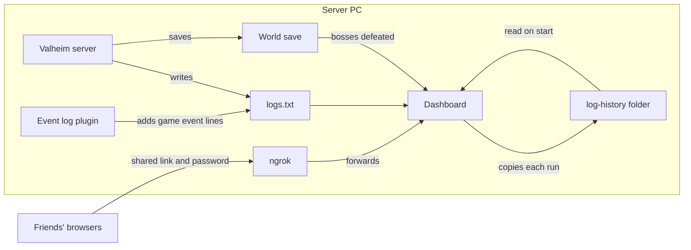

## Parts

| Folder | What it is |
| --- | --- |
| `packages/valheim-log` | Turns log lines into game events and player sessions. No files, no network. |
| `apps/dashboard` | SvelteKit app on Node. Follows `logs.txt` and serves the page. |
| `plugins/event-log` | BepInEx plugin on the server only. Logs what the game does not. Friends install nothing. |
| `scripts` | Start the dashboard, keep it running and update it from `main` on Windows, and share it through ngrok. |
| `docs/log-events.md` | Every log line the dashboard reads, with its regex. |

## Reading a log line

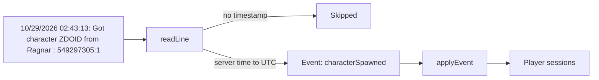

Server times are local (UTC−7 on this PC) and are stored as UTC. One Steam ID is one player.

## Showing times

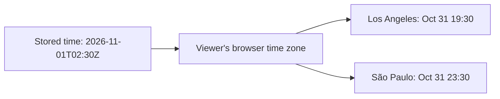

Every time on the dashboard is shown in the time zone of the browser looking at it. Each time uses the offset its zone had on that day, so times stay right after daylight saving changes.

## Following logs.txt

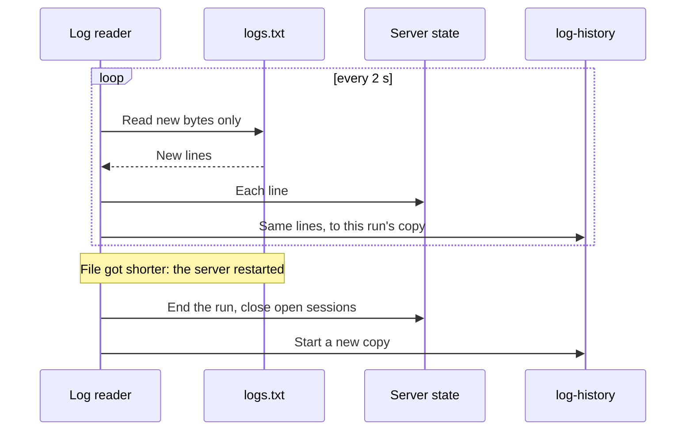

| A run ends as | When |
| --- | --- |
| `stopped` | The log has a clean stop line. |
| `crashed` | A new `logs.txt` started without a clean stop. |

## Starting the dashboard

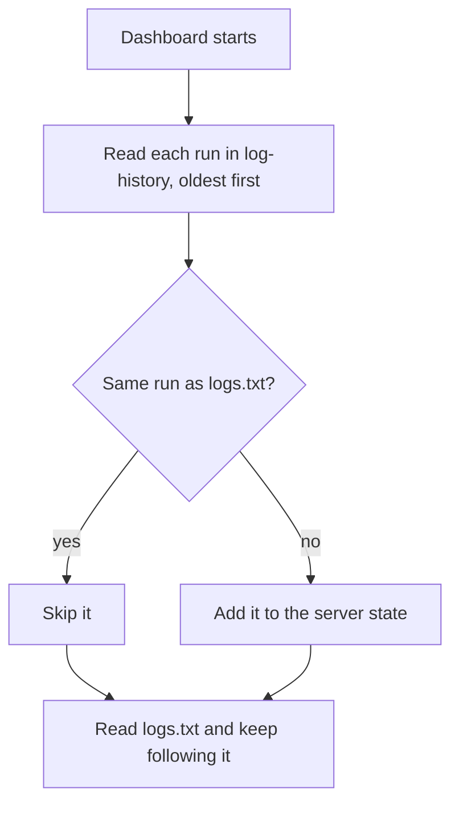

The server overwrites `logs.txt` on each start, so `log-history` keeps every run. Copies are named by the
run's first line, for example `20261030-154346.txt`.

## Live updates to the page

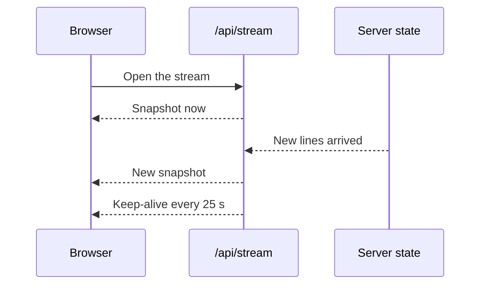

A snapshot is everything the page shows, as JSON. `/api/status` returns the same snapshot once.

## Sharing with friends

The dashboard listens only on the server PC (`127.0.0.1`). ngrok connects out from the PC and passes the
shared link's requests in, so no router port is open.

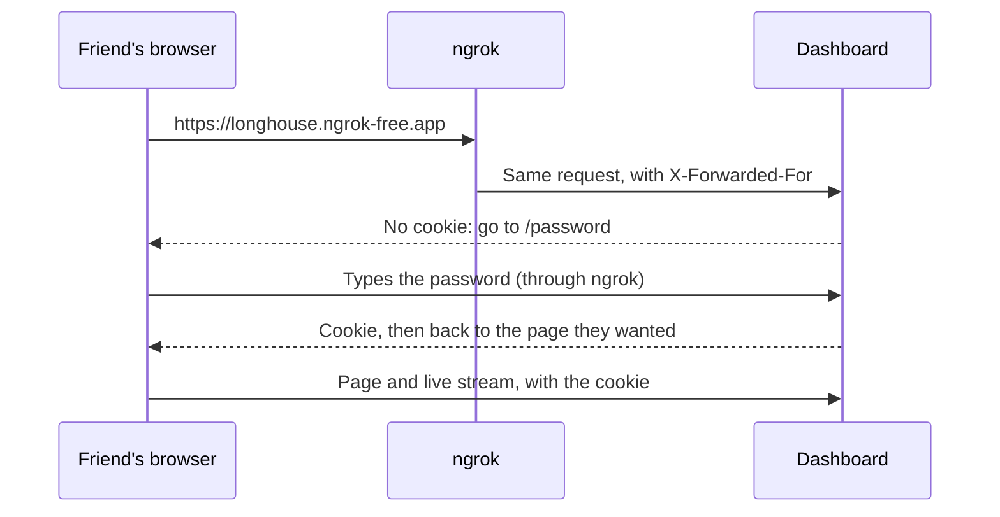

| A request | Gets |
| --- | --- |
| Made on the PC (host `localhost` or `127.0.0.1`, no `X-Forwarded-For`), such as `/api/status` for the updater | Served, no password |
| Through ngrok with the cookie | Served |
| Through ngrok without it | Sent to `/password`; `/api/*` answers `401` |
| Through ngrok when no password is set | Turned away (`403`) |

The password is the Valheim server's own, which the start script reads from `-password` in
`start_headless_server.bat`. The cookie (`dashboard_pass`) lasts 30 days. It holds a hash made from the password, so changing the
password sends everyone back to the password page. A wrong password waits 1 second before the answer, so
guessing is slow.

## Bosses defeated

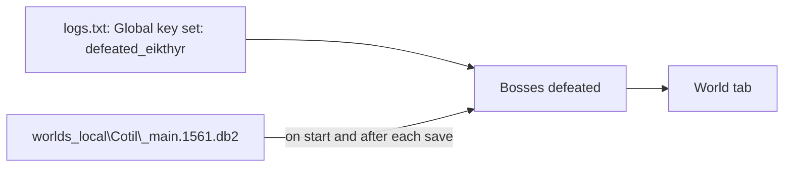

A boss defeat sets a global key, such as `defeated_eikthyr`, which the world save keeps. The log only has
defeats since the plugin was installed, so the dashboard also reads the keys from the newest save. A defeat
from the save shows on the World tab, but has no Saga line, since its time is not known.

## Tabs

| Tab | Shows | Data from |
| --- | --- | --- |
| Hall | Who is online and where, the last 24 hours on a day wheel, the latest events | Snapshot |
| Vikings | Each player, when they were online, kills, areas visited, and gear laid out like a character sheet | Snapshot |
| Saga | Every game event and chat, with filters | Snapshot |
| World | The in-game day, bosses defeated, saves, backups, disk space | Snapshot |
| Map | Land each player walked, chests with what they hold, who is where, last deaths | Snapshot |
| Recipes | Crafting plans and what is still missing | The viewer's browser |
| Server | Up or down, uptime in the last 24 hours, warnings | Snapshot |

Recipe plans are saved in each viewer's browser (`localStorage`). The server stores nothing for them.

The plugin logs gear the first time a player holds or wears it, not what they wear now. So the Vikings
character sheet puts the newest piece of each kind in its slot, for example the newest helmet on the head.
Tools, such as the hammer, and older pieces show under "Also carries".

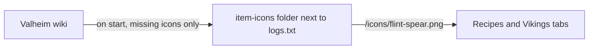

Icons are downloaded for every recipe item and every piece of gear the dashboard knows by name.

## Where a number comes from

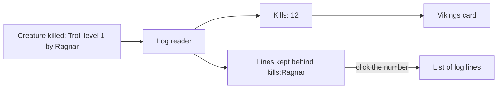

Each line that changes a number or an item on Vikings is kept with it, so a click shows the lines behind it,
newest first. Only the latest 50 lines per number are kept, but all of them are counted.

| Kept for | Lines |
| --- | --- |
| Time played, visits | Joins and leaves |
| Deaths | The game's death line and the plugin's death details |
| Kills, most killed | Creature killed |
| An area | Area entered |
| A piece of gear | Gear first seen, at each level |

Each Saga and Hall event keeps its lines too: a game event, chat message or ping has its own line, a death
has the game's line and the plugin's details, a join or leave has its line from the table above, and a
stretch of building, kills or items keeps its latest 50 lines. Every line in the list shows the rune, color
and label of its Saga kind.

## Event log plugin

The game logs joins, deaths and saves, but not building, chat or boss progress. The plugin watches what
already passes through the server and writes a line for each event.

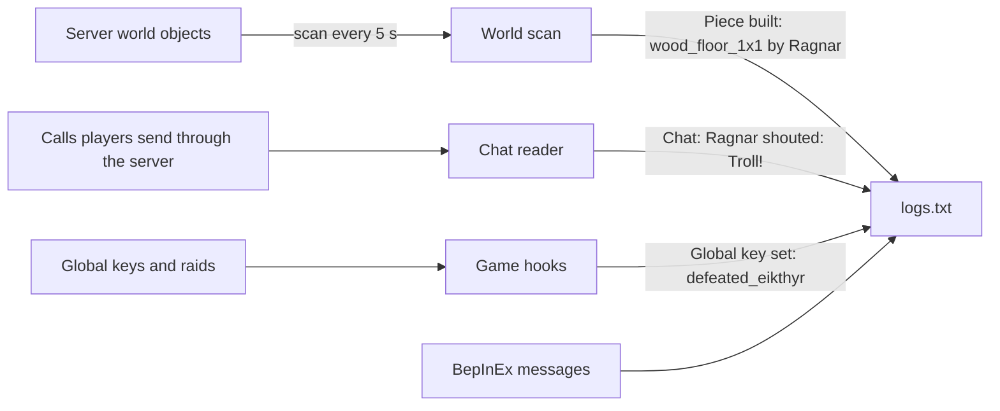

| Source | What it finds |
| --- | --- |
| World scan | New objects (pieces, summoned bosses), the in-game day, each player's position, area, portal trips, death, PvP, bed and gear, what each chest, cart, ship and new tombstone holds, tames, signs, item stands, chests and harvested plants, and objects destroyed, such as creatures with every player who hit them, items picked up and emptied tombstones |
| Calls through the server | Chat and map pings, which the server passes from one player to the others, creature attack moves, to say what a player was fighting when they died, and who asked to harvest a plant |
| Game hooks | Global keys, such as a boss defeat, and the end of a raid |

Each line names a player only when the game data says who did it.

The server sends its own log only to `logs.txt`, so the plugin also shows each event line in the server's
console window, for example `[Info   :Game event] Chat: Ragnar shouted: Troll!`. Only `logs.txt` feeds the
dashboard. The plugin turns off click-to-select in that window: a selection pauses writes to the window, which
would freeze the server.

On the dashboard, plugin lines become:

| Kept as | Lines | Shown as |
| --- | --- | --- |
| Activities | Pieces built or destroyed, kills, items gathered, chests | One Saga line per player and kind, until a 10 minute pause, naming every thing |
| Story events | Deaths, bosses, raids, portals, tames, signs, item stands, tombstones | One Saga line each |
| News only | Areas, gear, global keys | A Saga line for a first visit or a dungeon trip, new gear, or a boss defeat |
| Stats | Areas, kills, the day, boss keys | Where each player is now and their kills, areas and gear on Vikings, the day and bosses on World |
| Chat | Chat and pings | The Saga's "Chat and signs" filter, kept apart so it never pushes out events |
| Map | Positions, chests, tombstones | Explored squares, chests and last deaths on Map, and what each player carried at their last death on Vikings |

### Gathering

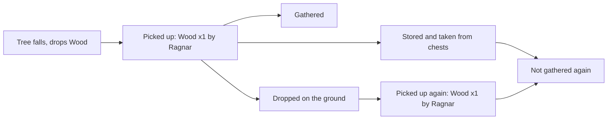

An item counts as gathered only the first time anyone picks it up. Harvest lines are not counted, since the
player then picks up what the plant drops, which is already counted.

### Map

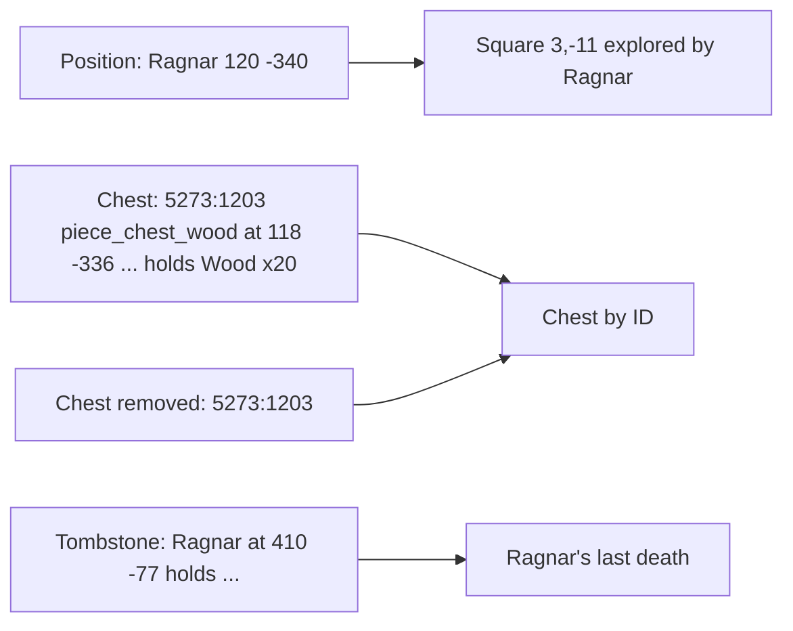

A position marks its whole 32 m square as explored. Chest IDs last until the server stops, and every run lists
all chests again, so a new run starts the chest list over.

BepInEx's own log file is turned off, so its messages land in
`logs.txt` too. Every line is listed in [log-events.md](log-events.md).

## Start scripts

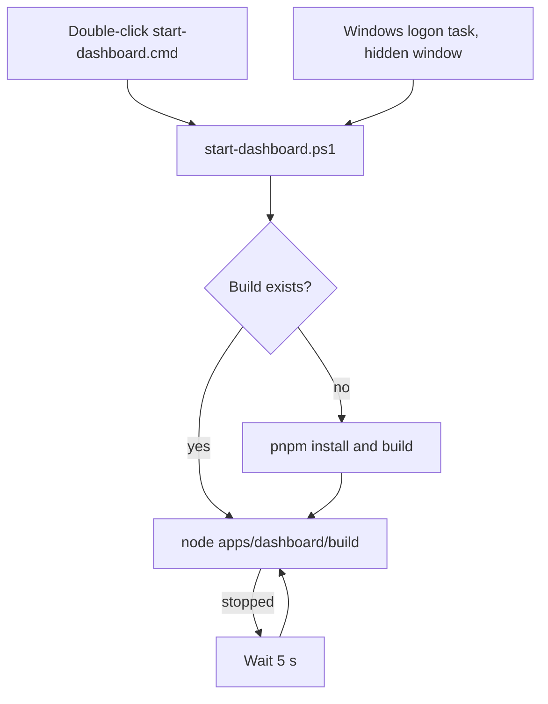

`install-startup.cmd` adds the logon task and the update task once. `share-dashboard.ps1` adds one more
that starts ngrok with no window. Every window stays hidden when it
starts at logon.

## Updates from main

The update task runs `update-from-main.ps1` every 5 minutes in a console with no window.

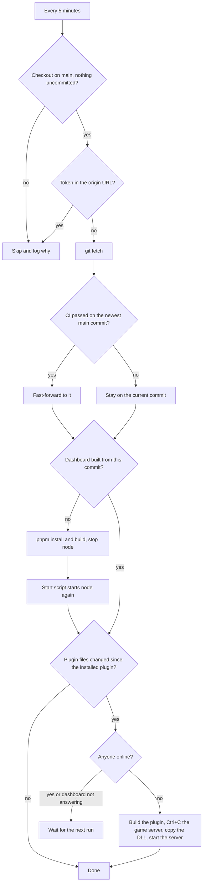

| Step | How |
| --- | --- |
| Who is online | Sessions without an end in `/api/status`. |
| Stopping the game server | Ctrl+C sent to its console, as in its window. The game saves the world and exits. |
| Starting the game server | `start_headless_server.bat` in its own console window, in the foreground. A server that was already stopped stays stopped. |
| Remembering what is installed | `updater-state.json` keeps the commit of the running dashboard and of the installed plugin. A step that fails or waits runs again on the next pass. |

The first run takes the installed plugin as current and builds the dashboard once.

### What it trusts

Whatever reaches `main` runs on the server PC as its Windows user, with nobody watching: the build scripts,
the plugin build and the plugin inside the game server. These keep that to reviewed code.

| Guard | What it stops |
| --- | --- |
| CI check | A commit runs only after the `ci` job passed on GitHub, read from GitHub's public check-runs API. |
| Fast-forward only | A rewritten `main` stops updates instead of being followed. |
| Installed pnpm | Builds use the pnpm `install-startup.cmd` installed, and stop if `package.json` asks for another version. Nothing downloads pnpm unattended. |
| `--frozen-lockfile` | Installs exactly the lockfile's packages, checked against their hashes. pnpm does not run packages' install scripts. |
| Dependabot cooldown | Upgrades are offered once a version has been out for 7 days. |
| Plain origin URL | A token in the URL could end up in `updater.log`, so the run skips. |
| Commit hashes only | Values from `updater-state.json` reach git only as full commit hashes. |

## Files on the server PC

Every log lives in `C:\Valheim Server`.

| File | Written by |
| --- | --- |
| `logs.txt` | The Valheim server, the event log plugin and BepInEx |
| `log-history\*.txt` | The dashboard, one file per server run |
| `dashboard.log` | The start script, with the dashboard's output |
| `updater.log` | The update script: what it updated, skipped or is waiting for |
| `updater-state.json` | The update script: commits of the running dashboard and the installed plugin |
| `ngrok.log` | ngrok, warnings and errors only |

The dashboard also reads the world save, `worlds_local\Cotil\_main.<save number>.db2`, and never writes to it.

## CI

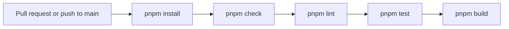

`pnpm lint` runs ESLint in each project. Besides the recommended TypeScript and Svelte rules, it rejects
relative imports (use `#/`), `function` declarations, `.then()`, `console` and `if` without braces.

The PowerShell scripts' tests run with Pester 5: `Invoke-Pester scripts`.

Dependabot opens weekly upgrade PRs for npm packages and GitHub Actions, for versions out for 7 days. The plugin is built on the
server PC, not in CI.
