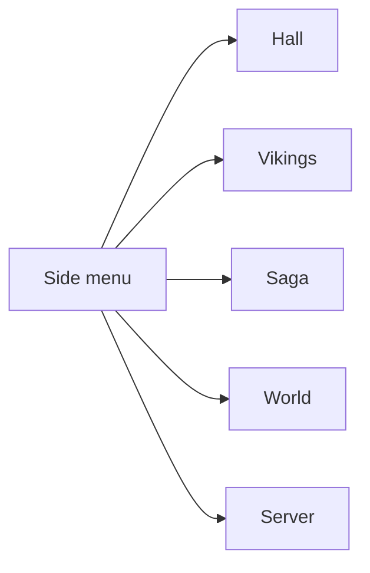
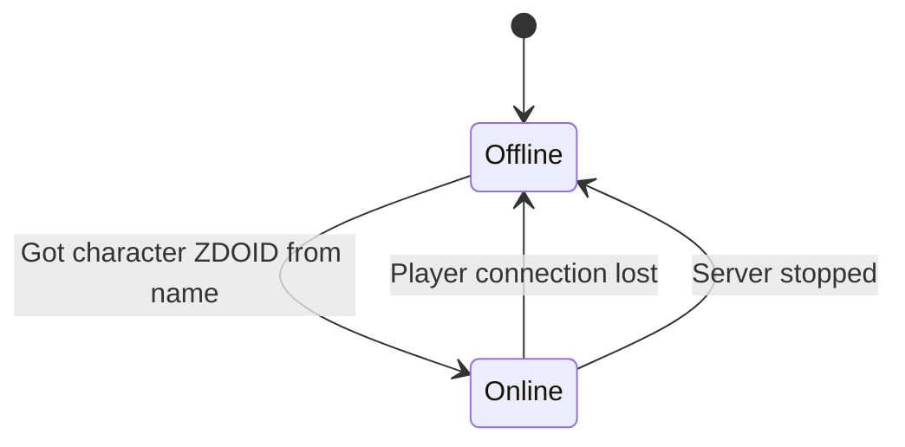
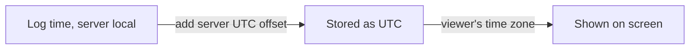

# Dashboard layout

How the dashboard screens are laid out and how each one gets its data from the server log.

Mockup: [Longhouse dashboard](https://claude.ai/artifact/48XWdTysdiayDjBmB2m9zw)

## Screens

A side menu switches between five tabs. Hall is the first screen and stays short. The other tabs
hold the details.

| Tab | Shows |
| --- | --- |
| Hall | One line about the day, a 24-hour wheel of who was online, who is online now, the last 5 events, one line of server status |
| Vikings | A time bar per player for the day, and a card per player with time played, visits and deaths |
| Saga | Every game event, newest first, with filters and the raw log line |
| World | Save cadence, boss progress, auto backups |
| Server | Status, uptime bar, warnings and restarts |

Errors and warnings only appear on the Server tab. Hall links to it with one line.

## Who is online

Online players come from join and leave events, not from the clock. A player is online from their
join until their leave, or until the server stops.

If the log ends while a player is still online, the dashboard says "online at last log line" with
that time. It does not say "online now" unless the log was written in the last few minutes.

## Players

One Steam ID is one player. The card shows the character name first and the Steam name under it,
for example "Ragnar, Steam: Tony Example". See [log events](log-events.md) for how the IDs link.

## Time zones

Log times have no time zone. They are the local time of the machine that runs the server.

| Setting | Meaning | Default |
| --- | --- | --- |
| Server UTC offset | Time zone of the server machine, used to read log times | The time zone of the machine that reads the log |

The header shows which time zone the times are in, for example "times in UTC−7".

## Look

| Part | Value |
| --- | --- |
| Background | `#17140F` |
| Panel | `#211C16` |
| Lines | `#3A3226` |
| Text | `#EDE3D1` |
| Muted text | `#A99B85` |
| Main accent | `#E8873A` |
| Second accent | `#8CC3D6` |
| Good | `#9DBB86` |
| Boss | `#D8B24C` |
| Headings | Cinzel |
| Body | Barlow |
| Times and log lines | IBM Plex Mono |

Corners are square, panels have thin borders and no shadows. Each event type has a rune icon and a
color, and always a text label too, so color is never the only cue.

| Event | Rune | Color |
| --- | --- | --- |
| Join | ᛗ | `#8CC3D6` |
| Leave | ᛗ | `#A99B85` |
| Death | ᚦ | `#E2735A` |
| Raid | ᚺ | `#E8873A` |
| World save, backup | ᛃ | `#9DBB86` |
