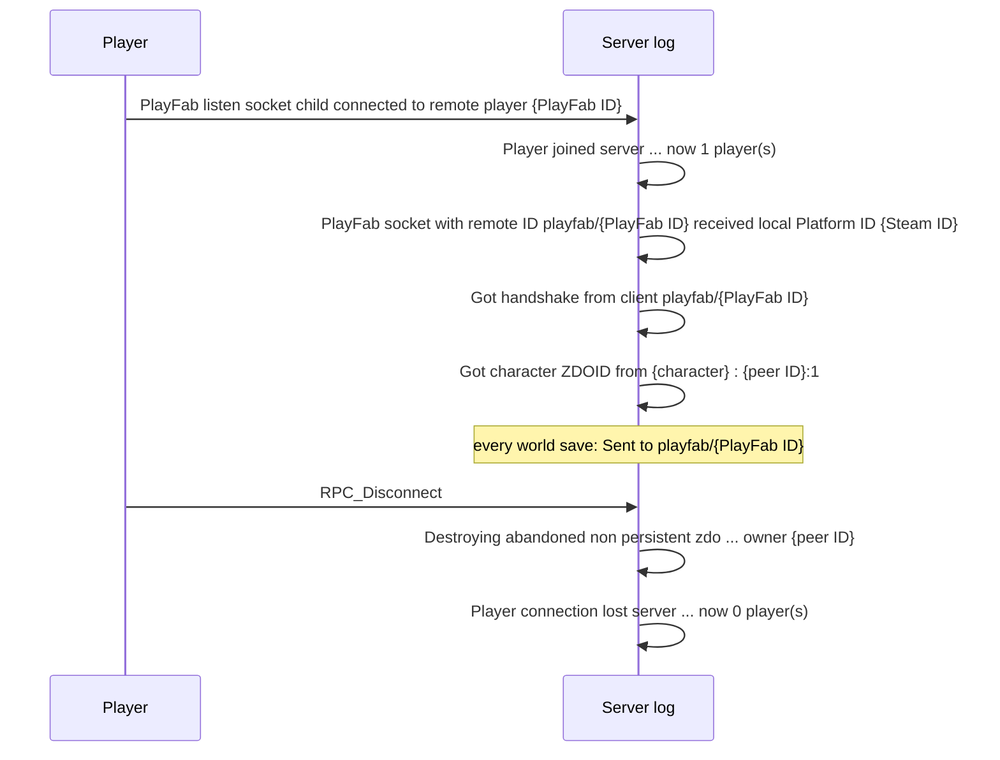
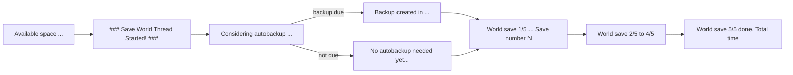

# Valheim server log events

Which game events the dedicated server writes to `logs.txt`, and the regex to read each one.

Based on a Valheim 1.0.21 server with crossplay on. Names, IDs, IP and join code in the examples are
replaced.

## Line format

```
10/29/2026 02:43:13: Got character ZDOID from Ragnar : 549297305:1
```

Timestamp regex: `^(?<month>\d{2})/(?<day>\d{2})/(?<year>\d{4}) (?<time>\d{2}:\d{2}:\d{2}): (?<message>.*)$`

- Time is server local time, month first.
- Lines without a timestamp come from the Unity engine. Skip them.
- The event regexes below match `message`. They work in Dart as raw strings, for example
  `RegExp(r'^RPC_Disconnect$')`.
- The server overwrites `logs.txt` on each start, so the dashboard must keep its own copy of events.

## Player IDs

| ID | Example | Lasts |
| --- | --- | --- |
| Steam ID | `Steam_76561198000000001` | Always |
| Steam name | `Tony Example` | Always |
| PlayFab ID (crossplay connection) | `A1B2C3D4E5F60718` | One connection |
| Character name | `Ragnar` | Always (one Steam account can have many) |
| ZDOID | `549297305:1` (peer ID `:` object ID) | One connection |

## Join and leave



How to link the lines into one session:

1. The PlayFab ID links the connect, Steam ID and handshake lines.
2. The first `Got character ZDOID` after a handshake belongs to that player. It gives the character
   name and the peer ID.
3. The leave is the `Destroying abandoned ... owner {peer ID}` line with the same peer ID.
4. `RPC_Disconnect` and the `now N player(s)` lines have no player in them. Use them only for counts.
5. If a leave is missed, `Sent to playfab/{PlayFab ID}` at each world save lists who is still online.

| Event | Example | Regex |
| --- | --- | --- |
| Known player (at startup) | `Player history entry with index 0:  Tony Example (Steam_76561198000000001, 3C9D07E1B2A4F856)` | `^Player history entry with index (?<index>\d+):\s+(?<steamName>.+) \((?<steamId>\w+_\d+), (?<playFabId>[0-9A-F]+)\)$` |
| Connected | `PlayFab listen socket child connected to remote player A1B2C3D4E5F60718` | `^PlayFab listen socket child connected to remote player (?<playFabId>[0-9A-F]+)$` |
| Player count up | `Player joined server "FlanServer" that has join code 123456, now 1 player(s)` | `^Player joined server "(?<server>.+)" that has join code (?<joinCode>\d+), now (?<players>\d+) player\(s\)$` |
| Steam ID | `PlayFab socket with remote ID playfab/A1B2C3D4E5F60718 received local Platform ID Steam_76561198000000001` | `^PlayFab socket with remote ID playfab/(?<playFabId>[0-9A-F]+) received local Platform ID (?<steamId>\w+_\d+)$` |
| Handshake | `Got handshake from client playfab/A1B2C3D4E5F60718` | `^Got handshake from client (?<client>\S+)$` |
| Character spawned | `Got character ZDOID from Ragnar : 549297305:1` | `^Got character ZDOID from (?<character>.+) : (?<peerId>-?\d+):(?<objectId>\d+)$` |
| Disconnect | `RPC_Disconnect` | `^RPC_Disconnect$` |
| Player objects removed | `Destroying abandoned non persistent zdo 549297305:9175 owner 549297305` | `^Destroying abandoned non persistent zdo (?<peerId>-?\d+):(?<objectId>\d+) owner (?<owner>-?\d+)$` |
| Player count down | `Player connection lost server "FlanServer" that has join code 123456, now 0 player(s)` | `^Player connection lost server "(?<server>.+)" that has join code (?<joinCode>\d+), now (?<players>\d+) player\(s\)$` |
| Still online (each save) | `Sent to playfab/A1B2C3D4E5F60718` | `^Sent to (?<client>\S+)$` |
| Connection count (each save) | ` Connections 1 ZDOS:140218  sent:0 recv:260` | `^ Connections (?<connections>\d+) ZDOS:(?<zdos>\d+)  sent:(?<sent>\d+) recv:(?<recv>\d+)$` |

The connection count line starts with a space and has two spaces before `sent`.

## Deaths, raids and bosses

None of these happened in the sample log. The first two come from how Valheim behaves and need a
check against a real log.

| Event | Log line | Regex |
| --- | --- | --- |
| Death | `Got character ZDOID from Ragnar : 0:0` | Character spawned regex, with peer ID and object ID both `0` |
| Raid | `Random event set:army_eikthyr` | `^Random event set:(?<event>\w+)$` |
| Boss killed | Not logged | The world file stores keys such as `defeated_eikthyr` |

## World saves and backups

A world save runs every 10 minutes, with or without players.



| Event | Example | Regex |
| --- | --- | --- |
| Save started | ` ### Save World Thread Started! ### ` | `^ ### Save World Thread Started! ### $` |
| Save step | `World save (1/5) Cloud & Backup checks done [2ms] => Save number 1184` | `^World save \((?<step>\d)/5\) (?:(?<stepName>.+?) )?done(?:\. Total time)? \[(?<ms>\d+)ms\](?: => Save number (?<saveNumber>\d+))?$` |
| Backup check | `Considering autobackup for World. World time: 590.7997, short time: 7200, long time: 43200, backup count: 4` | `^Considering autobackup for World\. World time: (?<worldTime>[\d.]+), short time: (?<shortTime>\d+), long time: (?<longTime>\d+), backup count: (?<backupCount>\d+)$` |
| Backup skipped | `No autobackup needed yet...` | `^(?:Skipping backup\. World session not long enough\.\|No autobackup needed yet\.\.\.)$` |
| Backup replaced | `Replacing backup file: Cotil_backup_auto-20261029-031214` | `^Replacing backup file: (?<backup>\S+)$` |
| Backup created | `Backup created in Cotil_backup_auto-20261029-051215 [23.522ms]` | `^Backup created in (?<backup>\S+) \[(?<ms>[\d.]+)ms\]$` |
| Disk space | `Available space to current user: 278588960768. Saving is blocked if below: 14960956 bytes. Warnings are given if below: 29921912` | `^Available space to current user: (?<available>\d+)\. Saving is blocked if below: (?<blockedBelow>\d+) bytes\. Warnings are given if below: (?<warnBelow>\d+)$` |

- `World time` is in-game seconds. One in-game day is 1800 seconds, so day = `floor(worldTime / 1800) + 1`.
- No save line for more than about 10 minutes means the server was down.
- `\|` in a table cell is a plain `|` in the regex.

## Server start

| Event | Example | Regex |
| --- | --- | --- |
| Version | `Valheim version: 1.0.21 (network version 41)` | `^Valheim version: (?<version>[\d.]+) \(network version (?<network>\d+)\)$` |
| Modded | `isModded: False` | `^isModded: (?<isModded>True\|False)$` |
| World loaded | `ZNet.LoadWorld: Cotil (Cotil), save number 1183` | `^ZNet\.LoadWorld: (?<world>.+?) \((?<file>.+?)\), save number (?<saveNumber>\d+)$` |
| Join code | `Session "FlanServer" registered with join code 123456` | `^Session "(?<server>.+)" registered with join code (?<joinCode>\d+)$` |
| Server online | `Session "FlanServer" with join code 123456 and IP 203.0.113.10:2456 is active with 0 player(s)` | `^Session "(?<server>.+)" with join code (?<joinCode>\d+) and IP (?<ip>[\d.]+):(?<port>\d+) is active with (?<players>\d+) player\(s\)$` |
| Game server | `Game server connected` | `^Game server (?<state>connected\|disconnected)$` |

## Errors and other lines

Not game events. Keep them out of the timeline.

| Kind | Example |
| --- | --- |
| Unity startup warnings | `Shader 'Custom/Water': fallback shader 'Diffuse' not found` |
| Missing script | `The referenced script on this Behaviour (Game Object '<null>') is missing!` |
| Retries | `Sending PlayFab login request (attempt 2)` |
| PlayFab upkeep | `Update PlayFab entity token` |
| Save internals | `PrepareSave: ZDOExtraData.PrepareSave done [35ms]` |
| Low disk | Disk space line where `available` is under `warnBelow`. Saving stops under `blockedBelow`. |
