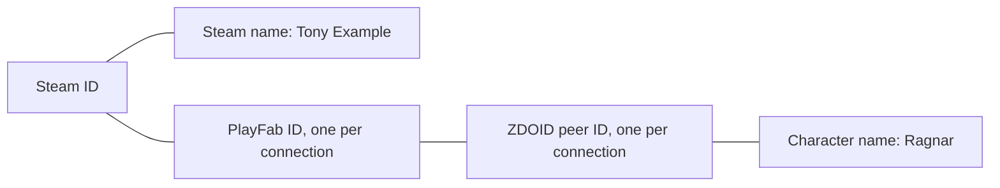
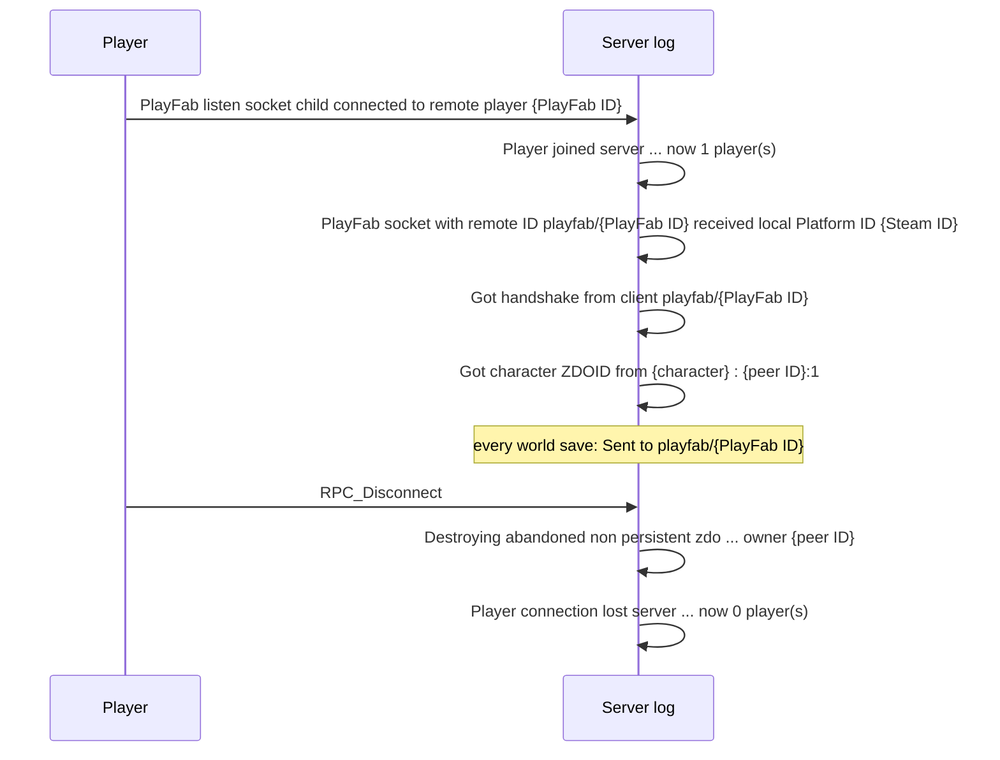
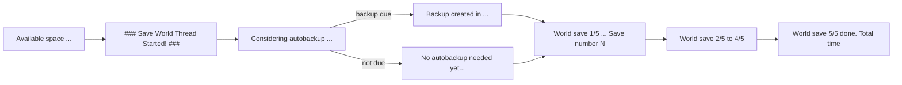

# Valheim server log events

Which game events the dedicated server writes to `logs.txt`, and the regex to read each one.

Based on a Valheim 1.0.21 server with crossplay on. Names, IDs, IP and join code in the examples are
replaced.

## Line format

```
10/29/2026 02:43:13: Got character ZDOID from Ragnar : 549297305:1
```

Timestamp regex: `^(?<month>\d{2})/(?<day>\d{2})/(?<year>\d{4}) (?<time>\d{2}:\d{2}:\d{2}): (?<message>.*)$`

- Time is server local time, month first.
- Lines without a timestamp come from the Unity engine. Skip them.
- The event regexes below match `message`. They work in Dart as raw strings, for example
  `RegExp(r'^RPC_Disconnect$')`.
- The server overwrites `logs.txt` on each start, so the dashboard must keep its own copy of events.

## Player IDs

The log names one player in several ways. Group them under the Steam ID: one Steam ID is one person.



| ID | Example | Lasts |
| --- | --- | --- |
| Steam ID | `Steam_76561198000000001` | Always |
| Steam name | `Tony Example` | Always |
| PlayFab ID (crossplay connection) | `A1B2C3D4E5F60718` | One connection |
| Character name | `Ragnar` | Always (one Steam account can have many) |
| ZDOID | `549297305:1` (peer ID `:` object ID) | One connection |

In the sample log, Steam name `Tony Example` and character `Ragnar` are the same person. Show the
player as one entry, for example `Ragnar (Tony Example)`.

The server's own Steam ID (`Caching Steam ID: 76561197960265728`) and `Server ID` at startup belong
to the server, not to a player.

## Join and leave



How to link the lines into one session:

1. The PlayFab ID links the connect, Steam ID and handshake lines.
2. The first `Got character ZDOID` after a handshake belongs to that player. It gives the character
   name and the peer ID.
3. The leave is the `Destroying abandoned ... owner {peer ID}` line with the same peer ID.
4. `RPC_Disconnect` and the `now N player(s)` lines have no player in them. Use them only for counts.
5. If a leave is missed, `Sent to playfab/{PlayFab ID}` at each world save lists who is still online.

| Event | Example | Regex |
| --- | --- | --- |
| Known player (at startup) | `Player history entry with index 0:  Tony Example (Steam_76561198000000001, 3C9D07E1B2A4F856)` | `^Player history entry with index (?<index>\d+):\s+(?<steamName>.+) \((?<steamId>\w+_\d+), (?<playFabId>[0-9A-F]+)\)$` |
| Connected | `PlayFab listen socket child connected to remote player A1B2C3D4E5F60718` | `^PlayFab listen socket child connected to remote player (?<playFabId>[0-9A-F]+)$` |
| Player count up | `Player joined server "FlanServer" that has join code 123456, now 1 player(s)` | `^Player joined server "(?<server>.+)" that has join code (?<joinCode>\d+), now (?<players>\d+) player\(s\)$` |
| Steam ID | `PlayFab socket with remote ID playfab/A1B2C3D4E5F60718 received local Platform ID Steam_76561198000000001` | `^PlayFab socket with remote ID playfab/(?<playFabId>[0-9A-F]+) received local Platform ID (?<steamId>\w+_\d+)$` |
| Handshake | `Got handshake from client playfab/A1B2C3D4E5F60718` | `^Got handshake from client (?<client>\S+)$` |
| Character spawned | `Got character ZDOID from Ragnar : 549297305:1` | `^Got character ZDOID from (?<character>.+) : (?<peerId>-?\d+):(?<objectId>\d+)$` |
| Disconnect | `RPC_Disconnect` | `^RPC_Disconnect$` |
| Player objects removed | `Destroying abandoned non persistent zdo 549297305:9175 owner 549297305` | `^Destroying abandoned non persistent zdo (?<peerId>-?\d+):(?<objectId>\d+) owner (?<owner>-?\d+)$` |
| Player count down | `Player connection lost server "FlanServer" that has join code 123456, now 0 player(s)` | `^Player connection lost server "(?<server>.+)" that has join code (?<joinCode>\d+), now (?<players>\d+) player\(s\)$` |
| Still online (each save) | `Sent to playfab/A1B2C3D4E5F60718` | `^Sent to (?<client>\S+)$` |
| Connection count (each save) | ` Connections 1 ZDOS:140218  sent:0 recv:260` | `^ Connections (?<connections>\d+) ZDOS:(?<zdos>\d+)  sent:(?<sent>\d+) recv:(?<recv>\d+)$` |

The connection count line starts with a space and has two spaces before `sent`.

## Deaths, raids and bosses

None of these happened in the sample log. The lines below come from other server owners' logs
(see Sources).

| Event | Example | Regex |
| --- | --- | --- |
| Death | `Got character ZDOID from Ragnar : 0:0` | Character spawned regex with peer ID `0` and object ID `0` |
| Respawn | `Got character ZDOID from Ragnar : 549297305:2` | Character spawned regex, the next one after a death |
| Raid check | `Possible events:1` | `^Possible events:(?<count>\d+)$` |
| Raid started | `Random event set:army_theelder` | `^Random event set:(?<event>\w+)$` |

The server checks for a raid about every 46 minutes. `Possible events:0` means no raid can happen
yet. The log has no line for when a raid ends.

Raid names:

| Name | Message in game | Unlocked by |
| --- | --- | --- |
| `army_eikthyr` | Eikthyr rallies the creatures of the forest. | Start of the world |
| `army_theelder` | The forest is moving... | Eikthyr |
| `army_bonemass` | A foul smell from the swamp... | The Elder |
| `army_moder` | A cold wind blows from the mountains. | Bonemass |
| `army_goblin` | The horde is attacking! | Moder |
| `foresttrolls` | The ground is shaking. | A troll kill and The Elder |
| `skeletons` | A skeleton surprise! | Bonemass |
| `blobs` | A foul smell from the swamp... | Bonemass |
| `ghosts` | You feel a chill down your spine... | Bonemass |
| `wolves` | You are being hunted... | Bonemass |
| `surtlings` | There's a smell of sulfur in the air... | A surtling kill and Bonemass |
| `bats` | You stirred the cauldron. | A bat kill and Bonemass |
| `army_gjall` | What's up, Gjall?! | Yagluth |
| `army_seekers` | They sought you out. | Yagluth |
| `army_charred` | The undead army marches. | The Queen |
| `army_charredspawners` | The dead have been summoned. | The Queen |
| `hildirboss1` to `hildirboss3` | (Hildir quest bosses) | Returning Hildir's chests |

### Boss kills

The server does not log boss kills. It stores them as keys in the world save
(`worlds_local/<world>/_main.<N>.db2`, highest `N`). The file has a 16-byte header, then gzip data
that holds the keys as plain text.

| Key | Boss |
| --- | --- |
| `defeated_eikthyr` | Eikthyr |
| `defeated_gdking` | The Elder |
| `defeated_bonemass` | Bonemass |
| `defeated_dragon` | Moder |
| `defeated_goblinking` | Yagluth |
| `defeated_queen` | The Queen |
| `defeated_fader` | Fader |

The sample world `Cotil` has `defeated_eikthyr` and `killedtroll`. A new key between two saves
means that boss was killed between those save times.

## Other events

Also not in the sample log.

| Event | Example | Regex |
| --- | --- | --- |
| Player timed out | `ZRpc timeout detected` | `^ZRpc timeout detected` (a leave, like `RPC_Disconnect`) |
| Night skipped (players slept) | a line containing `day:2` | `day:(?<day>\d+)` (day counts from 0, so this is day 3) |
| Server stopped | `OnApplicationQuit` | `OnApplicationQuit` |
| Network trouble | `Resume TX on playfab/A1B2C3D4E5F60718` | `^Resume TX on playfab/(?<playFabId>[0-9A-F]+)` |
| World loaded (before 1.0.7) | `Load world: Cotil (Cotil)` | `^Load world: (?<world>.+?) \(` |
| World saved (before 1.0) | `World saved ( 120ms )` | `^World saved \( (?<ms>.+)ms \)` |

`OnApplicationQuit` may have no timestamp. If the log ends without it, the server crashed or was
killed. Tools only match `day:` as text; nobody publishes the full night-skip line.

## Event log plugin

The game does not log building, chat or boss progress. The event log plugin in `plugins/event-log`
runs on the server only and writes these lines. A player is the character name, or `an unknown player`
when the plugin does not know who it was.

| Event | Example | Regex |
| --- | --- | --- |
| Piece built | `Piece built: wood_floor_1x1 by Ragnar` | `^Piece built: (?<piece>\S+) by (?<builder>.+)$` |
| Piece destroyed or removed | `Piece destroyed: wood_fence built by Ragnar` | `^Piece destroyed: (?<piece>\S+) built by (?<builder>.+)$` |
| Chat | `Chat: Ragnar shouted: Troll at the gate!` | `^Chat: (?<character>.+?) (?<kind>said\|shouted\|whispered): (?<text>.*)$` |
| Map ping | `Ping: Ragnar at 120 -340` | `^Ping: (?<character>.+) at (?<x>-?\d+) (?<z>-?\d+)$` |
| Global key set or removed | `Global key set: defeated_eikthyr` | `^Global key (?<change>set\|removed): (?<key>.+)$` |
| Raid ended | `Raid ended: army_eikthyr` | `^Raid ended: (?<raid>\w+)$` |
| Boss summoned | `Boss summoned: Eikthyr by Ragnar` | `^Boss summoned: (?<boss>\S+) by (?<summoner>.+)$` |
| New in-game day | `Day started: 42` | `^Day started: (?<day>\d+)$` |
| Player died | `Player died: Ragnar in BlackForest while fighting Troll` | `^Player died: (?<character>.+?) in (?<area>\w+)(?: while fighting (?<fighting>.+))?$` |
| Area entered | `Area entered: Ragnar Swamp` | `^Area entered: (?<character>.+) (?<area>\w+)$` |
| Came out of a portal | `Teleported: Ragnar to Home base` | `^Teleported: (?<character>.+?) to (?<portal>.+)$` |
| PvP turned on or off | `PvP turned on: Ragnar` | `^PvP turned (?<state>on\|off): (?<character>.+)$` |
| Went to bed | `Went to bed: Ragnar` | `^Went to bed: (?<character>.+)$` |
| New gear | `Gear: Ragnar SwordIron quality 2` | `^Gear: (?<character>\S+) (?<item>\S+)(?: quality (?<quality>\d+))?$` |
| Creature killed | `Creature killed: Troll level 2 by Ragnar, Bjorn` | `^Creature killed: (?<creature>\S+) level (?<level>\d+) by (?<attackers>.+)$` |
| Tame tamed, born, grown up or died | `Tame born: Wolf_cub` | `^(?<change>Tamed\|Tame born\|Tame grew up\|Tame died): (?<creature>\S+)(?: (?<name>.+))?$` |
| Tame named | `Pet named: Wolf Fluffy` | `^Pet named: (?<creature>\S+) (?<name>.+)$` |
| Sign written | `Sign written: Ragnar: Keep out` | `^Sign written: (?<author>.+?): (?<text>.*)$` |
| Item hung on a stand | `Item hung: TrophyDeer by Ragnar` | `^Item hung: (?<item>\S+) by (?<player>.+)$` |
| Item picked up | `Picked up: Wood x20 by Ragnar`, or `Picked up again: Wood x20 by Ragnar` | `^Picked up(?<again> again)?: (?<item>\S+) x(?<count>\d+) by (?<player>.+)$` |
| Items put in or taken from a chest | `Stored: Wood x20 in piece_chest_wood by Ragnar` | `^(?<change>Stored\|Taken): (?<item>\S+) x(?<count>\d+) (?:in\|from) (?<chest>\S+) by (?<player>.+)$` |
| Plant harvested | `Harvested: RaspberryBush by Ragnar` | `^Harvested: (?<plant>\S+) by (?<player>.+)$` |
| Tombstone emptied | `Tombstone emptied: Ragnar by Bjorn` | `^Tombstone emptied: (?<owner>.+?) by (?<player>.+)$` |

- **Chat** only reaches the server when another player is online to receive it. `said` is normal
  talk, `shouted` reaches everyone, `whispered` reaches players close by.
- **Global keys** mark world progress. The game sets `defeated_<boss>` each time a boss dies, for
  example `defeated_eikthyr`, `defeated_gdking` (The Elder) or `defeated_bonemass`.
- **Boss summoned** names the player whose offering summoned the boss.
- **Player died** comes with the game's own `Got character ZDOID from Ragnar : 0:0`. `while fighting`
  lists creatures that attacked within 5 seconds and 30 meters, and players who hit them in PvP.
- **Area** is a biome (`Meadows`, `BlackForest`, `Swamp`, `Mountain`, `Plains`, `Mistlands`,
  `AshLands`, `DeepNorth`, `Ocean`) or `Dungeon`. It is logged once the player stays in it for two scans.
- **Teleported** is the portal's name, or `an unnamed portal`.
- **Creature killed** lists every player who hit the creature, since each creature remembers them.
  Creatures that die without a player hitting them are not logged, except tames (`Tame died`).
  `level` is 1 for a creature with no stars.
- **Sign written**, **Item hung**, **Stored**, **Taken** and **Tombstone emptied** name the player whose
  game changed the object. A game takes over an object before it changes it.
- **Picked up** is only logged when that player stands within 10 meters of the item, since items left
  alone despawn, and no creature that eats off the ground stands within 3 meters of it. The game marks an
  item the first time it reaches anyone's inventory, and the mark stays through drops and chests. An item
  with the mark is logged as **Picked up again**.
- **Harvested** names the player who asked to harvest, or the player whose game owns the plant.
- **Gear** is logged the first time a player wears or holds an item since the server started.

To build it, install the .NET SDK and BepInExPack_Valheim on the server, run `dotnet build -c Release`
in `plugins/event-log`, and copy `bin\Release\netstandard2.1\ValheimDashboard.EventLog.dll` to the
server's `BepInEx\plugins` folder. Remove the older `ValheimDashboard.BuildLog.dll` if it is there.
After that, the update task in `scripts` installs each new version from `main` by itself.

The plugin also copies BepInEx's own messages, such as plugin errors, into `logs.txt` as
`[Error : Source] message` lines. To keep every log in the server's log folder, turn off BepInEx's
`LogOutput.log` in `BepInEx\config\BepInEx.cfg`: set `Enabled = false` under `[Logging.Disk]`.

## Refused joins

The player tried to connect and the server sent them away. Tools match these by the text in the
line, since the start of the line differs by version.

| Reason | Text in the line | Regex |
| --- | --- | --- |
| Wrong password | `Peer 76561198000000001 has wrong password` | `has wrong password` |
| Wrong game version | `... has incompatible version` | `has incompatible version` |
| Banned or not on the permitted list | `... is blacklisted or not in whitelist.` | `is blacklisted or not in whitelist` |
| Steam could not verify the player | `... has invalid session ticket` | `has invalid session ticket` |
| Server full (10 players) | `... disconnected due to server is full` | `server is full` |
| Blocked by the host (crossplay) | `The player with the ID ... is blocked by the server owner` | `is blocked by the server owner` |
| Not signed in to PlayFab (crossplay) | `... disconnected because they were not authenticated!` | `were not authenticated` |
| Platform not allowed (crossplay) | `Peer diconnected due to server platform privileges disallowing crossplay` | `disallowing crossplay` |

`diconnected` is spelled that way in the game.

## Steam-only servers

Without crossplay, the server writes Steam IDs instead of PlayFab IDs:

| Event | Example | Regex |
| --- | --- | --- |
| Connected | `Got connection SteamID 76561198000000001` | `^Got connection SteamID (?<steamId>\d+)$` |
| Handshake | `Got handshake from client 76561198000000001` | Handshake regex above |
| Wrong password | `Peer 76561198000000001 has wrong password` | `^Peer (?<steamId>\d+) has wrong password$` |
| Left | `Closing socket 76561198000000001` | `^Closing socket (?<steamId>\d+)$` (ignore `Closing socket 0`) |

## World saves and backups

A world save runs every 10 minutes, with or without players.



| Event | Example | Regex |
| --- | --- | --- |
| Save started | ` ### Save World Thread Started! ### ` | `^ ### Save World Thread Started! ### $` |
| Save step | `World save (1/5) Cloud & Backup checks done [2ms] => Save number 1184` | `^World save \((?<step>\d)/5\) (?:(?<stepName>.+?) )?done(?:\. Total time)? \[(?<ms>\d+)ms\](?: => Save number (?<saveNumber>\d+))?$` |
| Backup check | `Considering autobackup for World. World time: 590.7997, short time: 7200, long time: 43200, backup count: 4` | `^Considering autobackup for World\. World time: (?<worldTime>[\d.]+), short time: (?<shortTime>\d+), long time: (?<longTime>\d+), backup count: (?<backupCount>\d+)$` |
| Backup skipped | `No autobackup needed yet...` | `^(?:Skipping backup\. World session not long enough\.\|No autobackup needed yet\.\.\.)$` |
| Backup replaced | `Replacing backup file: Cotil_backup_auto-20261029-031214` | `^Replacing backup file: (?<backup>\S+)$` |
| Backup created | `Backup created in Cotil_backup_auto-20261029-051215 [23.522ms]` | `^Backup created in (?<backup>\S+) \[(?<ms>[\d.]+)ms\]$` |
| Disk space | `Available space to current user: 278588960768. Saving is blocked if below: 14960956 bytes. Warnings are given if below: 29921912` | `^Available space to current user: (?<available>\d+)\. Saving is blocked if below: (?<blockedBelow>\d+) bytes\. Warnings are given if below: (?<warnBelow>\d+)$` |

- `World time` is in-game seconds. One in-game day is 1800 seconds, so day = `floor(worldTime / 1800) + 1`.
- No save line for more than about 10 minutes means the server was down.
- `\|` in a table cell is a plain `|` in the regex.

## Server start

| Event | Example | Regex |
| --- | --- | --- |
| Version | `Valheim version: 1.0.21 (network version 41)` | `^Valheim version: (?<version>[\d.]+) \(network version (?<network>\d+)\)$` |
| Modded | `isModded: False` | `^isModded: (?<isModded>True\|False)$` |
| World loaded | `ZNet.LoadWorld: Cotil (Cotil), save number 1183` | `^ZNet\.LoadWorld: (?<world>.+?) \((?<file>.+?)\), save number (?<saveNumber>\d+)$` |
| Join code | `Session "FlanServer" registered with join code 123456` | `^Session "(?<server>.+)" registered with join code (?<joinCode>\d+)$` |
| Server online | `Session "FlanServer" with join code 123456 and IP 203.0.113.10:2456 is active with 0 player(s)` | `^Session "(?<server>.+)" with join code (?<joinCode>\d+) and IP (?<ip>[\d.]+):(?<port>\d+) is active with (?<players>\d+) player\(s\)$` |
| Game server | `Game server connected` | `^Game server (?<state>connected\|disconnected)$` |

## Errors and other lines

Not game events. Keep them out of the timeline.

| Kind | Example |
| --- | --- |
| Unity startup warnings | `Shader 'Custom/Water': fallback shader 'Diffuse' not found` |
| Missing script | `The referenced script on this Behaviour (Game Object '<null>') is missing!` |
| Retries | `Sending PlayFab login request (attempt 2)` |
| PlayFab upkeep | `Update PlayFab entity token` |
| Save internals | `PrepareSave: ZDOExtraData.PrepareSave done [35ms]` |
| Low disk | Disk space line where `available` is under `warnBelow`. Saving stops under `blockedBelow`. |

## Sources

- [Valheim Wiki: Events](https://valheim.fandom.com/wiki/Events) (raid names, messages, unlocks)
- [Valheim Wiki: Global Keys](https://valheim.weirdgloop.org/w/Global_Keys) (boss keys)
- [Valheim Modding Wiki: Event System](https://github-wiki-see.page/m/Valheim-Modding/Wiki/wiki/Event-System) (raid key rules)
- [Steam discussion: raid timing](https://steamcommunity.com/app/892970/discussions/0/3826413850820704361) (`Possible events`, `Random event set` lines)
- [valheim-server-docker discussion #397](https://github.com/lloesche/valheim-server-docker/discussions/397) (death `0:0`, raid and leave lines)
- [valheim-server-docker discussion #519](https://github.com/lloesche/valheim-server-docker/discussions/519) (`Closing socket`, handshake)
- [Join and leave script](https://gist.github.com/KevinPayravi/fe33a9b7d1b17e2747908950aa7a12f7) (Steam-only join and leave lines)
- [Example server log](https://gist.github.com/kgadberry/8703f734e53b76862c7d62aca828d664) (`Got connection SteamID`, wrong password)
- [vh-notify-ts](https://github.com/Viapatis/vh-notify-ts) (closest full list: timeout, night skip, server stop, network trouble)
- [Valheim connection errors](https://valheimdb.com/multiplayer/connection-errors) (refused join lines)
- [valheim-notify](https://github.com/Whiskey24/valheim-notify) (`day:`, `OnApplicationQuit`, `Load world`, death `: 0:`)
- [vikings log parser](https://github.com/nickpelone/vikings) (`World saved ( Nms )`, Steam connect and leave)
- [valheim-discord-monitor PR #50](https://github.com/alainator/valheim-discord-monitor/pull/50) (boss keys in the `.db2` save)
